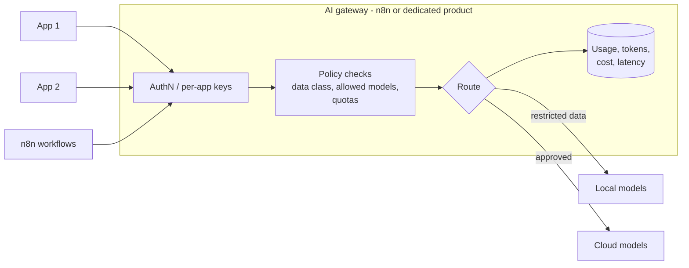

# Reference Architecture — AI Gateway

> **Status: outline.** Diagram and key design points are in place; full narrative is tracked in [docs/11-suggested-first-issues.md](../docs/11-suggested-first-issues.md).

**Use when:** several apps or teams consume models and you need consistent access control, routing, policy, logging and cost tracking.
**Built in:** [Module 09 n8n lab](../modules/09-ai-architecture-and-deployment/n8n-lab.md); telemetry from [workflow 10](../n8n-workflows/10-observability-workflow.json).

## Functions

Authentication; per-consumer quotas and budgets; data-classification routing; prompt and response logging with redaction; cost attribution; model abstraction (swap providers without app changes); caching where safe; policy enforcement (blocked topics, PII).

## n8n as a gateway: fit and limits

Good for POCs and moderate volume with rich policy logic. For high-throughput production, consider a dedicated gateway (open-source or commercial — check current options) with n8n as one consumer.
