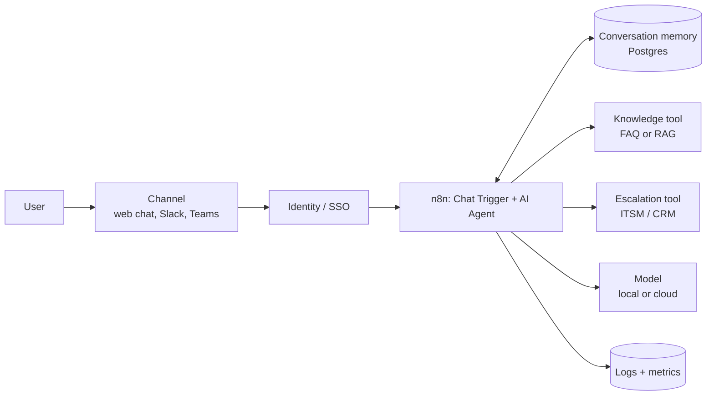

# Reference Architecture — Conversational AI

> **Status: outline.** Diagram and key design points are in place; full narrative is tracked in [docs/11-suggested-first-issues.md](../docs/11-suggested-first-issues.md).

**Use when:** users ask questions or request help in natural language (helpdesk, HR, customer support).
**Built in:** [Lab 03](../labs/lab-03-n8n-customer-support-chatbot/README.md) · [workflow 02](../n8n-workflows/02-chatbot-workflow.json)

## Key design decisions

| Decision | Options | Guidance |
|---|---|---|
| Grounding | FAQ tool, RAG, none | Never ship ungrounded for factual domains |
| Memory | Window (in-process), Postgres, Redis | Durable and access-controlled for production; short retention |
| Escalation | Ticket, live hand-off, callback | Pass a summary and transcript so users do not repeat themselves |
| Channel | Hosted chat, Slack, Teams, website widget | Authenticate users; rate-limit |

## Controls

Authentication on the chat endpoint; input length limits; PII guidance and redaction in logs; tool least privilege; escalation for security topics; evaluation on ambiguous, out-of-scope and hallucination-prone question sets.
