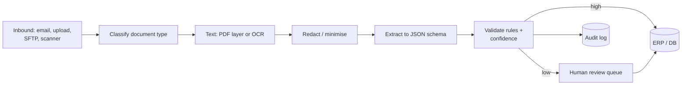

# Reference Architecture — Document Processing

> **Status: outline.** Diagram and key design points are in place; full narrative is tracked in [docs/11-suggested-first-issues.md](../docs/11-suggested-first-issues.md).

**Use when:** turning invoices, contracts, forms or reports into structured data.
**Built in:** [Lab 05](../labs/lab-05-n8n-document-intelligence-workflow/README.md) · [workflow 04](../n8n-workflows/04-document-processing-workflow.json)

## Controls

File type and size limits; malware scanning on upload; redaction before the model and before storage; deterministic validation; value thresholds for human approval; parameterised writes; audit trail.
