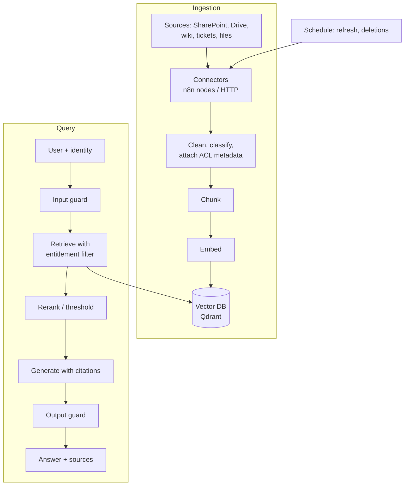

# Reference Architecture — Enterprise RAG

> **Status: outline.** Diagram and key design points are in place; full narrative is tracked in [docs/11-suggested-first-issues.md](../docs/11-suggested-first-issues.md).

**Use when:** answers must come from the organisation's own content, with citations.
**Built in:** [Lab 04](../labs/lab-04-n8n-rag-knowledge-assistant/README.md), hardened in [Lab 10](../labs/lab-10-secure-rag-with-guardrails/README.md).

## Key design decisions

| Decision | Guidance |
|---|---|
| Chunking | Start with 500–1,000 characters and overlap; tune with an eval set |
| Embeddings | One model per collection; record model and version in metadata |
| Access control | Enforce at retrieval using user entitlements, never by prompt |
| Freshness | Scheduled re-ingestion; handle deletions explicitly |
| Citations | Store source, URL and last-updated date in metadata |
| Evaluation | Golden questions with expected sources; measure retrieval and answer quality |

## Controls

Index write access control; content sanitisation for indirect injection; insufficient-context refusal; output validation; logging with redaction.
