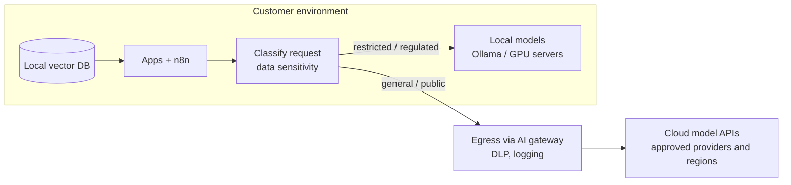

# Reference Architecture — Hybrid Cloud / Local AI

> **Status: outline.** Diagram and key design points are in place; full narrative is tracked in [docs/11-suggested-first-issues.md](../docs/11-suggested-first-issues.md).

**Use when:** some data must stay on-premises or in-region while other workloads benefit from frontier cloud models.

## Routing policy example

| Data class | Allowed models | Logging |
|---|---|---|
| Public | Local or approved cloud | Standard |
| Internal | Local, or cloud with enterprise terms (no training on data, defined retention — verify with the provider) | Redacted |
| Confidential / regulated | Local only | Redacted, restricted access |

## Trade-offs

Quality vs control; GPU capital cost vs per-token operating cost; operational burden of local models; latency; vendor lock-in. Decide with the same evaluation set run on both routes.
