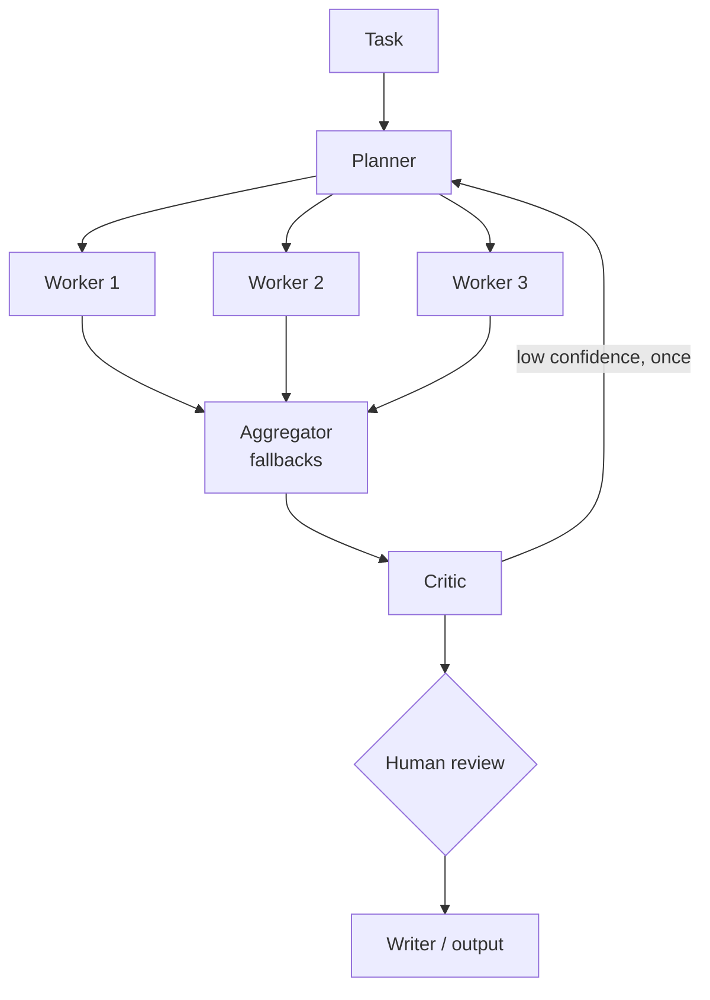

# Reference Architecture — Multi-Agent

> **Status: outline.** Diagram and key design points are in place; full narrative is tracked in [docs/11-suggested-first-issues.md](../docs/11-suggested-first-issues.md).

**Use when:** a task benefits from distinct roles (plan, research, critique, write) and a single agent measurably underperforms.
**Built in:** [Lab 08](../labs/lab-08-n8n-multi-agent-research-assistant/README.md) · [workflow 07](../n8n-workflows/07-multi-agent-orchestration.json)

## Patterns in n8n

| Pattern | n8n implementation |
|---|---|
| Pipeline | Sequential chains or agents connected by main connections |
| Fan-out / fan-in | Code node splits items; Code node aggregates |
| Agent-as-tool | **Call n8n Sub-Workflow Tool** attached to a coordinator AI Agent |
| Human gate | Wait node (webhook or form) or n8n human review for tools |

## Watch-outs

Cost and latency multiply; errors compound; loops need hard limits; accountability needs per-agent logging.
