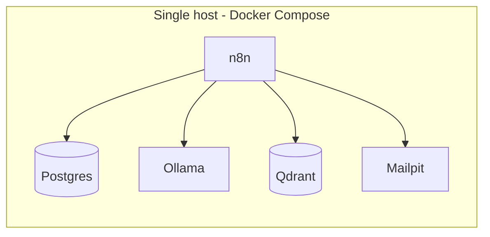
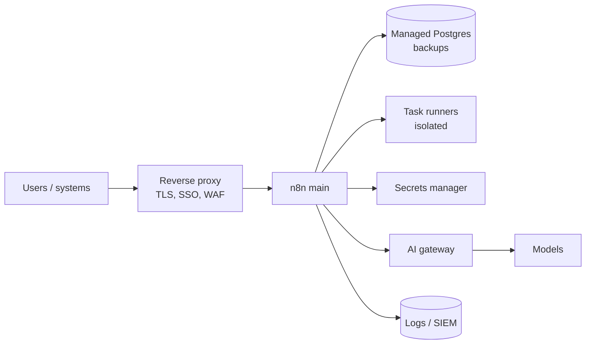
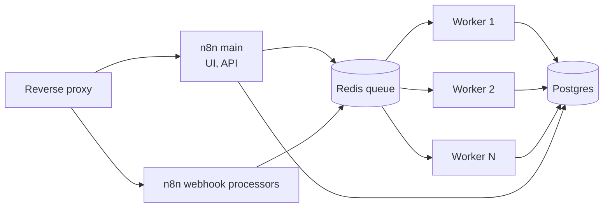

# n8n Reference Architectures

> **Status: outline.** Diagram and key design points are in place; full narrative is tracked in [docs/11-suggested-first-issues.md](../docs/11-suggested-first-issues.md).

How to deploy and operate n8n for AI workloads, from laptop to production. See also [03 — n8n setup and operations guide](../docs/03-n8n-setup-and-operations-guide.md).

## 1. Lab / POC (this repo)

## 2. Production — single instance, hardened

## 3. Production — queue mode (scale-out)

Check the current [n8n scaling docs](https://docs.n8n.io/hosting/scaling/overview/) for queue-mode configuration and supported options.

## Operational checklist

Pinned image versions; staged upgrades with smoke tests; backups (database, encryption key, workflows in Git); execution data retention; an error workflow on every production workflow; monitoring of queue depth, failures and latency; environment separation (dev/test/prod) with workflow promotion via Git or export/import.
