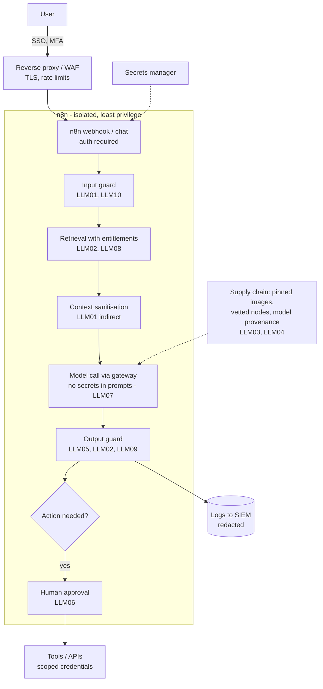

# Secure AI Reference Architecture (with n8n)

> **Status: outline.** Diagram and key design points are in place; full narrative is tracked in [docs/11-suggested-first-issues.md](../docs/11-suggested-first-issues.md).

Defence in depth for LLM applications, mapped to the OWASP Top 10 for LLM Applications (2025). Practised in [Lab 10](../labs/lab-10-secure-rag-with-guardrails/README.md) and [Lab 11](../labs/lab-11-ai-security-red-team/README.md). See the [AI security playbook](../docs/06-ai-security-playbook.md).

## Control checklist by layer

| Layer | Controls |
|---|---|
| Identity | SSO, MFA, per-user entitlements passed to retrieval |
| Network | No direct exposure; TLS; egress allow-list for model APIs and tools |
| n8n platform | 2.x secure defaults (env access blocked, file access restricted, Execute Command disabled); isolated task runners; RBAC; pinned versions |
| Data | Classification; redaction; retention; encryption at rest; protected backups |
| Model | Approved model list; local models for restricted data; provider terms reviewed |
| Application | Input, retrieval and output guards; schemas; fail-closed behaviour |
| Actions | Least-privilege tools; approvals; value limits; audit |
| Operations | Monitoring, alerting, red-team regression, incident runbook |
