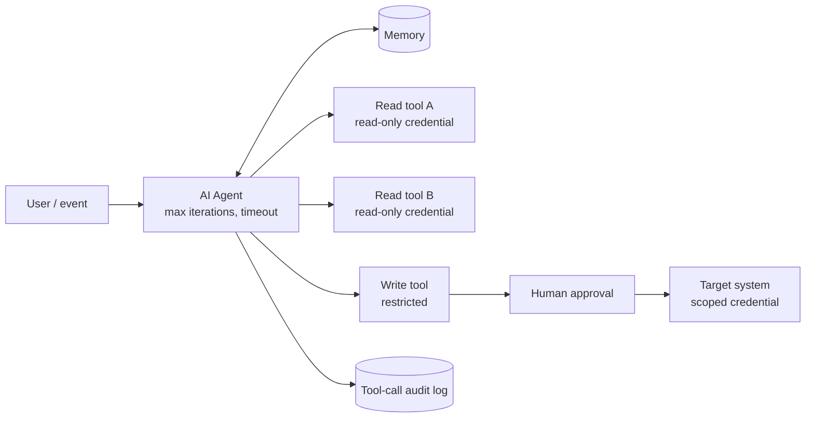

# Reference Architecture — Single Agent

> **Status: outline.** Diagram and key design points are in place; full narrative is tracked in [docs/11-suggested-first-issues.md](../docs/11-suggested-first-issues.md).

**Use when:** the path to an answer varies and needs a few tools, but one role is enough.
**Built in:** [Lab 07](../labs/lab-07-n8n-single-agent-tool-use/README.md) · [workflow 06](../n8n-workflows/06-single-agent-tool-use.json)

## Design rules

1. Fewest tools that do the job; clear names and descriptions.
2. Read-only by default; write tools gated by approval and value limits.
3. One credential per tool, least privilege.
4. Log every tool call with input, output and execution ID.
5. Cap iterations and time; return tool errors as text.
