# 00 — Learning Path

This program has **13 phases** delivered through **14 modules** and **13 labs**. Every phase builds something in n8n. Every phase ends with a consultant artifact you could use with a customer tomorrow.

Choose a path:

| Path | Time per week | Best for |
|---|---|---|
| **Standard (12 weeks)** | 5–7 hours | Learning alongside a full customer workload |
| **Accelerated (4 weeks)** | 15–20 hours | Bootcamp, enablement sprint, or a new-hire ramp |

## How the phases build

```mermaid
flowchart LR
  P1[1 Foundations<br/>Lab 01-02] --> P2[2 Conversational AI<br/>Lab 03]
  P2 --> P3[3 RAG<br/>Lab 04]
  P3 --> P4[4 AI workflows<br/>Lab 06, 09]
  P4 --> P5[5 Document AI<br/>Lab 05]
  P5 --> P6[6 Single agent<br/>Lab 07]
  P6 --> P7[7 Multi-agent<br/>Lab 08]
  P7 --> P8[8 Architecture<br/>AI gateway]
  P8 --> P9[9 Observability<br/>Lab 12]
  P9 --> P10[10 AI security<br/>Lab 10]
  P10 --> P11[11 Red teaming<br/>Lab 11]
  P11 --> P12[12 Governance<br/>AI inventory]
  P12 --> P13[13 Capstone<br/>Lab 13]
```

## Phase details

Each row lists what you learn, what you build in n8n, and the consultant artifact you produce.

### Phase 1 — AI foundations and LLM literacy (Modules 01, 02)

- **Learn:** tokens, embeddings, context window, temperature, cost, latency, hallucination, prompting patterns.
- **Build in n8n:** Docker n8n + Ollama; a basic LLM workflow with structured JSON output and error handling ([Lab 01](../labs/lab-01-local-llm-and-n8n-setup/README.md)); a prompt playground ([Lab 02](../labs/lab-02-prompt-engineering-playground/README.md)).
- **Artifact:** a one-page "How LLMs work" explainer for a non-technical buyer.

### Phase 2 — Conversational AI (Module 03)

- **Learn:** chatbots vs copilots vs agents, memory, grounding, escalation design, conversation testing.
- **Build in n8n:** Chat Trigger + AI Agent + Simple Memory + tools; FAQ knowledge; escalation; tests for ambiguous, out-of-scope and hallucination-prone questions ([Lab 03](../labs/lab-03-n8n-customer-support-chatbot/README.md)).
- **Artifact:** chatbot demo script with persona and talk track.

### Phase 3 — RAG and enterprise knowledge (Module 04)

- **Learn:** chunking, embeddings, vector search, citations, freshness, access control on retrieval.
- **Build in n8n:** ingestion (chunk, embed, store in Qdrant), query with citations, scheduled refresh, a small evaluation set, an "insufficient context" guardrail ([Lab 04](../labs/lab-04-n8n-rag-knowledge-assistant/README.md)).
- **Artifact:** enterprise RAG architecture one-pager.

### Phase 4 — AI workflows with n8n (Module 05)

- **Learn:** deterministic workflow vs agent, retries, idempotency, exception queues, error workflows, logging.
- **Build in n8n:** email/ticket triage ([Lab 06](../labs/lab-06-n8n-email-triage-agent/README.md)), lead enrichment, approvals and exception queues ([Lab 09](../labs/lab-09-n8n-human-in-the-loop-approval/README.md)).
- **Artifact:** n8n workflow design review using [the checklist](../templates/n8n-workflow-design-review-checklist.md).

### Phase 5 — Document intelligence (Module 06)

- **Learn:** OCR (optical character recognition), extraction to a JSON schema, validation, confidence, redaction.
- **Build in n8n:** extraction → validation → exception routing → human approval for low confidence → results to Postgres ([Lab 05](../labs/lab-05-n8n-document-intelligence-workflow/README.md)).
- **Artifact:** document-AI POC success criteria.

### Phase 6 — Single-agent systems (Module 07)

- **Learn:** tool calling, the agent loop, tool descriptions, memory, excessive agency, failure modes.
- **Build in n8n:** Tools Agent with 3 tools, memory, tool-call logging, one restricted tool behind human approval ([Lab 07](../labs/lab-07-n8n-single-agent-tool-use/README.md)).
- **Artifact:** agent risk register entries.

### Phase 7 — Multi-agent systems (Module 08)

- **Learn:** planner/worker/critic patterns, when multi-agent is overkill, fallbacks, cost blow-up.
- **Build in n8n:** planner, researcher, critic and report generator with human review; report with sources, confidence, limitations and next actions ([Lab 08](../labs/lab-08-n8n-multi-agent-research-assistant/README.md)).
- **Artifact:** "single vs multi-agent" decision memo.

### Phase 8 — Architecture and deployment (Module 09)

- **Learn:** Compose deployment, environment variables, persistence, backups, queue mode, AI gateways, local vs cloud model routing.
- **Build in n8n:** an n8n AI gateway (model access, logging, policy checks, cost tracking); a FastAPI RAG service called from n8n.
- **Artifact:** solution design one-pager with deployment options.

### Phase 9 — Observability and evaluation (Module 10)

- **Learn:** what to log, golden datasets, offline vs online evaluation, quality/cost/latency metrics.
- **Build in n8n:** logging to Postgres, alerts, an evaluation workflow, metrics summary ([Lab 12](../labs/lab-12-ai-observability-and-cost-dashboard/README.md)).
- **Artifact:** POC measurement plan.

### Phase 10 — AI security fundamentals (Module 11)

- **Learn:** OWASP Top 10 for LLM Applications, direct and indirect prompt injection, sensitive data leakage, excessive agency, improper output handling, supply chain, shadow AI.
- **Build in n8n:** a deliberately vulnerable RAG workflow (isolated), then the hardened version with mitigations, and a residual-risk statement ([Lab 10](../labs/lab-10-secure-rag-with-guardrails/README.md)).
- **Artifact:** AI security review checklist for a customer design.

### Phase 11 — AI red teaming (Module 12)

- **Learn:** threat modelling for AI, test design, severity rating, reporting.
- **Build in n8n:** a test harness for injection, jailbreak, leakage, tool abuse and insecure output ([Lab 11](../labs/lab-11-ai-security-red-team/README.md)).
- **Artifact:** red-team findings report.

### Phase 12 — Governance, responsible AI and compliance (Module 13)

- **Learn:** AI policies, model and use-case inventory, approvals, NIST AI RMF and ISO/IEC 42001 concepts, EU AI Act risk tiers (check current guidance), privacy and retention.
- **Build in n8n:** a use-case and model inventory with approval flow and periodic risk reports.
- **Artifact:** responsible AI checklist and governance one-pager.

### Phase 13 — Capstone (Module 14)

- **Build:** a Secure Enterprise Knowledge and Workflow Assistant ([spec](../modules/14-capstone-secure-enterprise-ai-advisor/README.md)).
- **Deliver:** demo, architecture diagram, threat model, security review, risk register, evaluation results, exec one-pager, POC plan and business case.

## 12-week standard path

| Week | Phase | Modules | Labs | Hours | Artifact due |
|---|---|---|---|---|---|
| 1 | 1 | 01 | Lab 01 | 5–6 | LLM explainer |
| 2 | 1 | 02 | Lab 02 | 5–6 | Prompt pattern cheat sheet |
| 3 | 2 | 03 | Lab 03 | 6–7 | Chatbot demo script |
| 4 | 3 | 04 | Lab 04 | 6–7 | RAG one-pager |
| 5 | 4 | 05 | Lab 06, Lab 09 | 6–7 | Workflow design review |
| 6 | 5 | 06 | Lab 05 | 6–7 | Document-AI POC criteria |
| 7 | 6 | 07 | Lab 07 | 6–7 | Agent risk entries |
| 8 | 7 | 08 | Lab 08 | 6–7 | Single vs multi-agent memo |
| 9 | 8, 9 | 09, 10 | Module 09 lab, Lab 12 | 7 | Solution one-pager + measurement plan |
| 10 | 10 | 11 | Lab 10 | 6–7 | Security review |
| 11 | 11, 12 | 12, 13 | Lab 11, Module 13 lab | 7 | Findings report + governance one-pager |
| 12 | 13 | 14 | Lab 13 | 8–10 | Capstone pack |

## 4-week accelerated path

| Week | Phases | Modules | Labs | Focus |
|---|---|---|---|---|
| 1 | 1–3 | 01–04 | 01, 02, 03, 04 | Literacy, chat, RAG |
| 2 | 4–7 | 05–08 | 05, 06, 07, 08, 09 | Workflows, documents, agents |
| 3 | 8–12 | 09–13 | 10, 11, 12 | Deploy, measure, secure, govern |
| 4 | 13 | 14 | 13 | Capstone build and presentation |

Accelerated tips:

1. Skip stretch goals on the first pass.
2. Do the knowledge checks; they take 10 minutes and expose gaps quickly.
3. Reuse your Lab 04 knowledge base and Lab 07 agent in the capstone.

## Completion criteria

You have completed the program when you can, without notes:

1. Run a 30-minute AI discovery call using the [discovery questionnaire](../templates/discovery-questionnaire.md).
2. Whiteboard a secure RAG or agent architecture and explain each control.
3. Demo your capstone to a technical and an executive audience.
4. Present a POC plan with measurable success criteria.
5. Walk a customer through their top five AI risks and the controls for each.

Start here: [01 — How to use this repo](01-how-to-use-this-repo.md).
