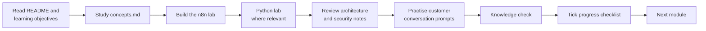

# 01 — How to Use This Repo

## The learning loop

Each module follows the same loop. Do it in order the first time.

## The 12 standard files in every module

| File | What it gives you |
|---|---|
| `README.md` | Why it matters for SCs, overview, time, links, next module |
| `learning-objectives.md` | What you can do after the module |
| `concepts.md` | Technical and business concepts in plain English |
| `n8n-lab.md` | The n8n build for this module (often points to a full lab in `labs/`) |
| `python-lab.md` | Python work, where relevant (says so when not) |
| `architecture.md` | Reference architecture with Mermaid diagrams |
| `security-considerations.md` | Risks, controls and governance points |
| `troubleshooting.md` | Failure modes and fixes |
| `customer-conversation-prompts.md` | Discovery questions, exec explanation, objections and responses |
| `knowledge-check.md` | Self-test with answers |
| `resources.md` | Verified external links |
| `progress-checklist.md` | Tick-box progress tracker |

## Tool labels

Every tool in this repo carries one or more labels:

| Label | Meaning |
|---|---|
| **Open source** | Source code is publicly available under an open-source or source-available licence |
| **Freemium** | Free tier exists; paid tiers add limits or features (check current pricing) |
| **Local** | Runs on your laptop; no data leaves your machine |
| **Cloud** | Runs as a hosted service; data leaves your machine |
| **Optional** | Not required to complete the core path |
| **Beginner-friendly** | Usable without coding |
| **Advanced** | Expect code, configuration and debugging |

## Safety conventions

- **No real data.** All sample data is synthetic. Do not paste customer data into labs.
- **Secrets** live in `.env` (never committed) or in n8n's encrypted credential store.
- **Vulnerable content** is always named `EDUCATIONAL-VULNERABLE`, sits inside a lab folder, and starts with this block:

> ⚠️ **EDUCATIONAL — INTENTIONALLY VULNERABLE.** Run only on your isolated local lab stack. Never deploy, expose to a network, or connect to real data or real accounts.

## Conventions in the text

- Commands are shown for **bash** (macOS, Linux, Git Bash, WSL). PowerShell equivalents appear where they differ.
- n8n node names match the n8n UI exactly (for example **AI Agent**, **Chat Trigger**, **Simple Memory**).
- Expressions use n8n syntax: `{{ $json.field }}`.
- "Check current docs" means the detail changes often or we could not verify it.

## Where to get help

1. The module's `troubleshooting.md`.
2. [08 — Troubleshooting guide](08-troubleshooting-guide.md).
3. [n8n community forum](https://community.n8n.io/) and [n8n docs](https://docs.n8n.io/).
4. Open a **Lab issue** using the GitHub issue template.

Next: [02 — Environment setup](02-environment-setup.md).
