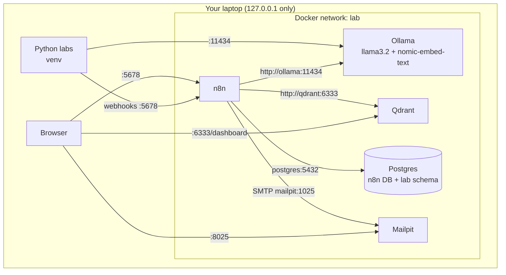

# 02 — Environment Setup

Goal: a local lab where n8n, Ollama, Qdrant, Postgres and Mailpit run in Docker, and Python 3.11+ runs on your machine. Everything is free and local. Nothing leaves your laptop unless you choose a cloud model.

## Architecture of the lab stack



## 1. Hardware

| Resource | Minimum | Recommended | Notes |
|---|---|---|---|
| RAM | 8 GB | 16 GB+ | 3B-parameter models run in about 4 GB; 8B models want 8 GB+ free |
| Disk | 15 GB free | 30 GB+ | Docker images plus models |
| CPU | 4 cores | 8 cores | CPU-only works; responses take seconds, not milliseconds |
| GPU | Not needed | NVIDIA with 8 GB+ VRAM | See the GPU note in `docker-compose.yml` |

Apple Silicon: Docker cannot use the Mac GPU. For faster local models, install [Ollama natively](https://ollama.com/download) and point n8n at `http://host.docker.internal:11434` (see step 6).

## 2. Install the tools

| Tool | Labels | Install |
|---|---|---|
| Docker Desktop (Windows/macOS) or Docker Engine + Compose plugin (Linux) | Freemium (Desktop licence terms apply to larger companies — check current terms), Local | https://docs.docker.com/get-docker/ |
| Git | Open source, Local | https://git-scm.com/downloads |
| Python 3.11+ | Open source, Local | https://www.python.org/downloads/ |
| make (optional) | Open source, Local | macOS/Linux built in; Windows via Git Bash/WSL or skip and use PowerShell commands below |
| Tesseract OCR (Lab 05 only, optional) | Open source, Local | https://tesseract-ocr.github.io/tessdoc/Installation.html |

Windows with winget:

```powershell
winget install -e --id Docker.DockerDesktop
winget install -e --id Git.Git
winget install -e --id Python.Python.3.12
```

Restart after installing Docker Desktop, open it once, and wait until it says the engine is running.

Check:

```bash
docker --version
docker compose version
git --version
python --version     # must be 3.11 or newer
```

## 3. Clone and configure

```bash
git clone https://github.com/dudhatalpesh/AI-for-Solutions-Consultants.git
cd AI-for-Solutions-Consultants
cp .env.example .env
```

PowerShell:

```powershell
git clone https://github.com/dudhatalpesh/AI-for-Solutions-Consultants.git
Set-Location AI-for-Solutions-Consultants
Copy-Item .env.example .env
New-Item -ItemType Directory -Force shared\kb, shared\inbox | Out-Null
```

Edit `.env` and replace every `CHANGE_ME`:

| Variable | What to set | How |
|---|---|---|
| `N8N_ENCRYPTION_KEY` | 64 random characters | `openssl rand -hex 32` (Git Bash) or PowerShell: `-join ((48..57)+(97..102) \| Get-Random -Count 64 \| % {[char]$_})` |
| `POSTGRES_PASSWORD` | A strong password | Any password manager generator |

> Keep `N8N_ENCRYPTION_KEY` safe. If you lose it, n8n cannot decrypt saved credentials.

## 4. Start the stack

```bash
docker compose up -d
docker compose ps
docker compose logs -f ollama-init
```

The `ollama-init` container pulls `llama3.2` (chat) and `nomic-embed-text` (embeddings) and then exits. The first pull downloads a few GB. When it shows success for both models, press `Ctrl+C`.

## 5. Verify each service

```bash
curl http://localhost:5678/healthz          # n8n: {"status":"ok"}
curl http://localhost:11434/api/tags        # Ollama: lists llama3.2 and nomic-embed-text
curl http://localhost:6333/collections      # Qdrant: {"result":{"collections":[]}, ...}
```

PowerShell: use `Invoke-RestMethod http://localhost:11434/api/tags` (or `curl.exe` instead of `curl`).

Quick model test:

```bash
docker compose exec ollama ollama run llama3.2 "In one sentence, what is a context window?"
```

Mailpit inbox: http://localhost:8025.

## 6. First n8n login and credentials

1. Open http://localhost:5678 and create the **owner account**. This is local only; use a lab password, not a work password.
2. Create these credentials (**Overview → Credentials → Create credential**, or from inside a node):

| Credential type (search name in n8n) | Field values | Used by |
|---|---|---|
| **Ollama** | Base URL: `http://ollama:11434` (native Ollama: `http://host.docker.internal:11434`) | All LLM and embedding nodes |
| **Qdrant** | Qdrant URL: `http://qdrant:6333`. API key: local Qdrant has no auth by default; if n8n insists on a value, enter any placeholder | Labs 04, 10 |
| **Postgres** | Host `postgres`, Database = `POSTGRES_DB`, User = `POSTGRES_USER`, Password = `POSTGRES_PASSWORD`, Port `5432`, SSL disabled | Labs 05, 07, 09, 12 |
| **SMTP** | Host `mailpit`, Port `1025`, no user/password, SSL/TLS off | Labs 09, 12 |

Name them exactly `Ollama (local)`, `Qdrant (local)`, `Postgres (lab)` and `SMTP (Mailpit)`. The labs refer to those names.

> Use container hostnames (`ollama`, `qdrant`, `postgres`, `mailpit`) inside n8n. Use `localhost` from your browser and from Python on your laptop.

## 7. Python environment

```bash
python -m venv .venv
source .venv/bin/activate          # PowerShell: .venv\Scripts\Activate.ps1
pip install --upgrade pip
pip install -r requirements.txt
```

If PowerShell blocks activation: `Set-ExecutionPolicy -Scope CurrentUser RemoteSigned` (this changes a user-level setting; skip it and run `.venv\Scripts\python.exe` directly if you prefer).

Run the environment check from Lab 01:

```bash
python labs/lab-01-local-llm-and-n8n-setup/check_env.py
```

## 8. Everyday commands

| Task | make | Plain Docker |
|---|---|---|
| Start | `make up` | `docker compose up -d` |
| Stop (keep data) | `make down` | `docker compose down` |
| n8n logs | `make logs` | `docker compose logs -f n8n` |
| Import all workflows | `make import-workflows` | see [03 — n8n guide](03-n8n-setup-and-operations-guide.md#importing-workflows) |
| Back up database | `make backup` | see [03 — n8n guide](03-n8n-setup-and-operations-guide.md#backups-and-restore) |
| Delete everything | `make reset` | `docker compose down -v` |

## 9. Optional cloud models

Local models keep data on your machine but are slower and less capable than frontier cloud models. To compare, add a cloud credential in n8n (OpenAI, Anthropic, Google Gemini, Groq and others are available as chat model sub-nodes). Rules:

1. Only use synthetic lab data with cloud models.
2. Check your organisation's AI policy first.
3. Check current pricing and free-tier limits on the provider's site.

## 10. Troubleshooting setup

| Symptom | Likely cause | Fix |
|---|---|---|
| `n8n` keeps restarting | `N8N_ENCRYPTION_KEY` or Postgres password missing | Check `.env`, then `docker compose logs n8n` |
| n8n says the encryption key does not match | You changed the key after first start | Restore the original key, or `docker compose down -v` to start fresh (deletes data) |
| Ollama node: "ECONNREFUSED" | Base URL uses `localhost` inside Docker | Use `http://ollama:11434` |
| Model not found | Pull did not finish | `docker compose exec ollama ollama pull llama3.2` |
| Very slow responses | CPU-only, or RAM pressure | Close apps, use a smaller model, or enable GPU |
| Port already in use | Another service on 5678/11434/6333/5432 | Stop it, or change the left-hand port in `docker-compose.yml` |
| File node "access denied" | Path outside `/data/shared` | Put files in `./shared/` and use `/data/shared/...` in n8n |

More: [08 — Troubleshooting guide](08-troubleshooting-guide.md). Next: [03 — n8n setup and operations](03-n8n-setup-and-operations-guide.md).
