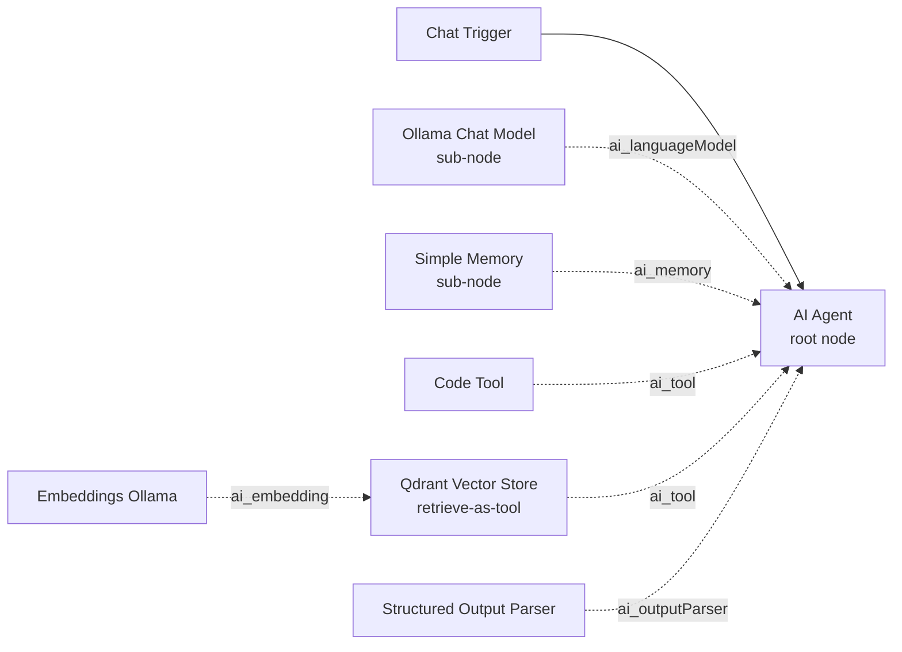
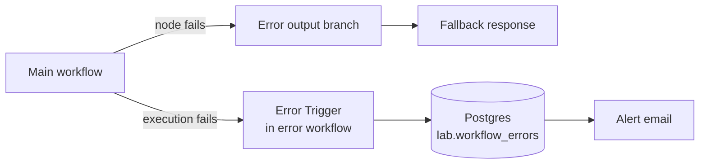

# 03 — n8n Setup and Operations Guide

n8n is the orchestration layer for every lab. This guide covers the concepts you need, how to import and run workflows, and how to operate n8n safely (errors, retries, logging, backups, upgrades, hardening).

> Written against **n8n 2.x** (stable 2.44.x in October 2026). n8n ships frequently. If a screen or option differs, check the [n8n docs](https://docs.n8n.io/) and [release notes](https://docs.n8n.io/release-notes/).

## Core concepts in 2 minutes

| Concept | What it is | SC analogy |
|---|---|---|
| **Workflow** | A graph of nodes that runs top to bottom along connections | A runbook that executes itself |
| **Trigger node** | Starts a workflow: Manual Trigger, Webhook, Schedule Trigger, Chat Trigger, Error Trigger, app triggers | The event source |
| **Node** | One step: call an API, transform data, branch, call a model | A task in the runbook |
| **Item** | n8n passes arrays of JSON items between nodes; most nodes run once per item | A row in a table |
| **Expression** | `{{ ... }}` JavaScript inside a field, e.g. `{{ $json.email }}` | A formula |
| **Credential** | Encrypted secret stored in n8n, referenced by nodes | A vault entry |
| **Execution** | One run of a workflow, with full input/output per node | A log of what happened |
| **Publish** | Makes production triggers live (n8n 2.x replaced the Activate toggle with Publish) | Change goes to prod |

## AI nodes: root nodes and sub-nodes

AI features in n8n use **cluster nodes**: a *root node* that does the work, with *sub-nodes* plugged into it.



Nodes used in this program (names as they appear in the n8n UI; internal type in brackets):

| Purpose | Node | Internal type |
|---|---|---|
| Agent with tools | **AI Agent** | `@n8n/n8n-nodes-langchain.agent` |
| Single prompt → answer | **Basic LLM Chain** | `@n8n/n8n-nodes-langchain.chainLlm` |
| Classification | **Text Classifier** | `@n8n/n8n-nodes-langchain.textClassifier` |
| Field extraction | **Information Extractor** | `@n8n/n8n-nodes-langchain.informationExtractor` |
| Chat UI / chat entry point | **Chat Trigger** | `@n8n/n8n-nodes-langchain.chatTrigger` |
| Local model | **Ollama Chat Model** | `@n8n/n8n-nodes-langchain.lmChatOllama` |
| Local embeddings | **Embeddings Ollama** | `@n8n/n8n-nodes-langchain.embeddingsOllama` |
| Short-term memory | **Simple Memory** | `@n8n/n8n-nodes-langchain.memoryBufferWindow` |
| Durable memory | **Postgres Chat Memory** | `@n8n/n8n-nodes-langchain.memoryPostgresChat` |
| JSON output | **Structured Output Parser** | `@n8n/n8n-nodes-langchain.outputParserStructured` |
| Vector store | **Qdrant Vector Store** | `@n8n/n8n-nodes-langchain.vectorStoreQdrant` |
| Quick in-memory vectors | **Simple Vector Store** | `@n8n/n8n-nodes-langchain.vectorStoreInMemory` |
| Loading documents | **Default Data Loader** | `@n8n/n8n-nodes-langchain.documentDefaultDataLoader` |
| Chunking | **Recursive Character Text Splitter** | `@n8n/n8n-nodes-langchain.textSplitterRecursiveCharacterTextSplitter` |
| Tools | **Code Tool**, **HTTP Request Tool**, **Call n8n Sub-Workflow Tool**, **Wikipedia**, **Calculator**, **Think Tool** | `toolCode`, `toolHttpRequest`, `toolWorkflow`, `toolWikipedia`, `toolCalculator`, `toolThink` |
| Safety checks | **Guardrails** | `@n8n/n8n-nodes-langchain.guardrails` (newer node — check current docs for options) |
| Model Context Protocol | **MCP Client Tool**, **MCP Server Trigger** | `mcpClientTool`, `mcpTrigger` |

Core nodes: **Webhook**, **Respond to Webhook**, **HTTP Request**, **Code**, **Edit Fields (Set)**, **IF**, **Switch**, **Merge**, **Wait**, **Schedule Trigger**, **Error Trigger**, **Execute Workflow Trigger**, **Read/Write Files from Disk**, **Extract from File**, **Postgres**, **Send Email**.

> **Tool calling needs a tool-capable model.** `llama3.2` and `qwen2.5` support tools in Ollama. If your agent never calls a tool, try another model first (see the [Ollama model library](https://ollama.com/library) "tools" tag).

## Importing workflows

### Option A — UI (recommended for learning)

1. In n8n, open **Overview** → **Create workflow** (or open an empty workflow).
2. Open the workflow menu (**⋯**) → **Import from File…** and choose a file from `n8n-workflows/`.
3. Open each node that shows a warning and select the matching credential (for example `Ollama (local)`).
4. Save.

You can also copy the JSON text and paste it straight onto the canvas.

### Option B — CLI (bulk)

The repo's `n8n-workflows/` folder is mounted read-only at `/data/workflows` in the n8n container.

```bash
docker compose exec n8n n8n import:workflow --input=/data/workflows/01-basic-llm-workflow.json
make import-workflows      # imports all ten
```

CLI imports do not attach credentials. Open each workflow and select credentials afterwards.

## Webhooks: test vs production URLs

| URL | When it works |
|---|---|
| `http://localhost:5678/webhook-test/<path>` | Only while you click **Execute workflow** / "Listen for test event" in the editor. One call per click. |
| `http://localhost:5678/webhook/<path>` | Only after the workflow is **published**. |

Most "404 webhook not registered" errors are a mix-up between these two.

Secure webhooks with the Webhook node's **Authentication** option (Basic Auth or Header Auth credential) for anything beyond a laptop lab.

## Expressions you will use constantly

| Expression | Returns |
|---|---|
| `{{ $json.body.question }}` | Field from the current item (Webhook puts the POST body under `body`) |
| `{{ $('Config').item.json.threshold }}` | Field from an earlier node by name |
| `{{ $execution.id }}` | Current execution ID (good for log correlation) |
| `{{ $execution.resumeUrl }}` | URL that resumes a **Wait** node set to "On Webhook Call" |
| `{{ $workflow.name }}` | Workflow name |
| `{{ $now.toISO() }}` | Current timestamp (Luxon) |
| `{{ JSON.stringify($json) }}` | Whole item as a string |

Common mistake: renaming a node breaks `$('Old Name')` references. n8n usually updates them, but check after renaming.

## Configuration without hardcoding

Every workflow in this repo starts with a **Config** node (**Edit Fields (Set)**) holding non-secret settings such as thresholds and internal service URLs. Change them there, not inside nodes.

Why not environment variables? n8n 2.x blocks `$env` access in the Code node and expressions by default (`N8N_BLOCK_ENV_ACCESS_IN_NODE=true`). We keep that secure default. Secrets always go in **credentials**.

## Errors, retries and timeouts

| Control | Where | Use it for |
|---|---|---|
| **Retry On Fail** | Node → Settings | Flaky APIs, model timeouts. Set Max Tries 2–3, Wait Between Tries 1000–5000 ms |
| **On Error** | Node → Settings: *Stop Workflow* / *Continue* / *Continue (using error output)* | Use the error output to route failures to a fallback or exception queue |
| **Timeout Workflow** | Workflow → Settings | Stop runaway executions (agents that loop) |
| **Error workflow** | Workflow → Settings → Error Workflow | Runs a separate workflow starting with **Error Trigger** whenever this one fails |
| **Max Iterations** | AI Agent → Options | Caps agent reasoning loops |

Pattern used in the labs:



## Logging and execution data

- Every execution is stored in the n8n database with full node input/output. That is great for debugging and **risky for sensitive data**: prompts and responses are stored too.
- Workflow → Settings lets you choose whether to save successful/failed executions and execution progress.
- Pruning environment variables (`EXECUTIONS_DATA_PRUNE`, `EXECUTIONS_DATA_MAX_AGE`) control retention — check the [environment variables docs](https://docs.n8n.io/hosting/configuration/environment-variables/) for current names and defaults.
- For AI telemetry (tokens, latency, cost), log explicitly to Postgres (Lab 12) rather than relying on execution history.

## Backups and restore

Back up three things: the **database**, the **encryption key**, and **workflow JSON in Git**.

```bash
# 1) Database (includes workflows, credentials (encrypted), executions)
docker compose exec -T postgres sh -c 'pg_dump -U "$POSTGRES_USER" "$POSTGRES_DB"' > backups/n8n-$(date +%F).sql

# 2) Workflows as JSON (for Git) — no credentials
docker compose exec n8n n8n export:workflow --all --separate --output=/data/shared/backups/

# 3) Keep N8N_ENCRYPTION_KEY in your password manager
```

Restore (into a fresh stack with the **same** encryption key):

```bash
docker compose up -d postgres
cat backups/n8n-YYYY-MM-DD.sql | docker compose exec -T postgres sh -c 'psql -U "$POSTGRES_USER" "$POSTGRES_DB"'
docker compose up -d
```

Before committing exported workflows: remove credential IDs and `pinData`, and check for customer data.

## Upgrades

1. Read the [release notes](https://docs.n8n.io/release-notes/) between your version and the target.
2. Back up (above).
3. Change `N8N_VERSION` in `.env`.
4. `docker compose pull n8n && docker compose up -d n8n`
5. Run Lab 01's workflow as a smoke test.

n8n 1.x → 2.x notable changes (see [2.0 breaking changes](https://docs.n8n.io/2-0-breaking-changes)): Publish replaces Activate; task runners on by default; `$env` blocked in Code nodes by default; Read/Write Files restricted by default; Execute Command node disabled by default; the Pyodide Python Code node removed.

## Hardening checklist (beyond the lab)

| Area | Control |
|---|---|
| Network | Do not expose n8n directly. Put it behind a reverse proxy with TLS and SSO; restrict webhook paths |
| Auth | Strong owner password, MFA; SSO/RBAC (role-based access control) on paid plans — check current plan features |
| Secrets | Credentials only; external secrets manager on supported plans; rotate keys |
| Code execution | Keep task runners isolated; keep `N8N_BLOCK_ENV_ACCESS_IN_NODE=true`; leave Execute Command disabled |
| Files | Keep `N8N_RESTRICT_FILE_ACCESS_TO` narrow |
| Webhooks | Authentication on every production webhook; validate and size-limit input |
| Data | Execution data retention and pruning; avoid logging sensitive fields |
| Supply chain | Vet community nodes before installing; pin image versions |
| Scale | Queue mode with Redis workers for higher throughput — see [scaling docs](https://docs.n8n.io/hosting/scaling/overview/) |

## Debugging toolkit

1. **Executions** list → open a failed run → inspect each node's input and output.
2. **Debug in editor** loads a past execution's data into the canvas.
3. **Pin data** on a node to replay downstream steps without calling the model again (saves time; remove pins before export).
4. Add a temporary **Code** node with `return $input.all();` to inspect items.
5. `docker compose logs -f n8n` for startup, credential and runner errors.

Next: [04 — Tool selection guide](04-tool-selection-guide.md).
