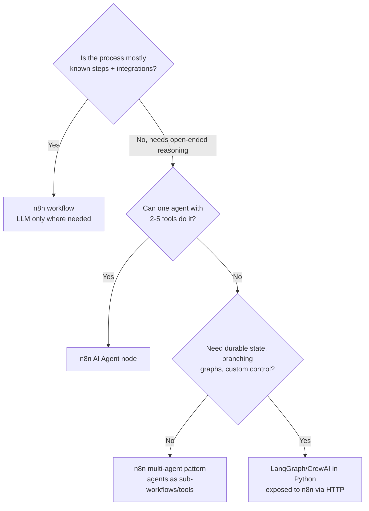

# 04 — Tool Selection Guide

How to choose tools for labs, demos and customer POCs, and how to explain the choice to a customer.

> Licences, features and pricing change. Labels below reflect public information checked in October 2026. **Check current docs and pricing before quoting a customer.** We do not list prices on purpose.

## Selection principles

1. **Local first.** If a lab can run on a laptop with synthetic data, it should. It removes data-privacy objections from the learning process.
2. **Open source or freemium.** Every core lab is free to run.
3. **n8n orchestrates; Python extends.** Use n8n for flow, integrations, approvals and logging. Use Python when you need custom logic, evaluation at scale, or a service n8n calls.
4. **Swap-ready.** Each layer has an alternative so you can match a customer's existing stack.
5. **Production is a different decision.** Lab choices are about learning speed. Customer production choices are about security, support, scale and contracts.

## Recommended stack by layer

### Orchestration and low-code

| Tool | Labels | Use it when | Watch out for |
|---|---|---|---|
| **n8n (self-hosted)** | Open source (fair-code: Sustainable Use License), Local, Beginner-friendly | Default for every lab: integrations, AI Agent, approvals, logging | Licence limits commercial resale/hosting — check the licence for customer deployments |
| n8n Cloud | Freemium (trial), Cloud | Customer wants managed service | Data leaves the customer's environment |
| Flowise | Open source, Local, Optional | Comparing visual LLM builders | Narrower integration catalogue than n8n |
| Power Automate / Zapier / Make | Freemium, Cloud, Optional | Customer is standardised on them | Discuss AI-specific features with the vendor |

### Models

| Tool | Labels | Use it when | Watch out for |
|---|---|---|---|
| **Ollama** | Open source (MIT), Local, Beginner-friendly | Default local model runtime | CPU-only is slow; small models are less accurate |
| Hugging Face Hub / Inference | Freemium, Cloud/Local | Open models, embeddings, model cards | Check model licences (some restrict commercial use) |
| LM Studio | Freemium, Local, Optional | GUI for local models | Licence terms for business use — check |
| Cloud APIs (OpenAI, Anthropic, Google, Mistral, Groq, Azure OpenAI, AWS Bedrock) | Freemium/paid, Cloud, Optional | Quality comparison, customer's chosen provider | Data residency, retention and cost — check current terms |

Suggested local models (check the [Ollama library](https://ollama.com/library) for current tags and sizes):

| Need | Model | Notes |
|---|---|---|
| Chat + tool calling, small laptop | `llama3.2` (3B) | Default in this repo |
| Better reasoning, 16 GB+ RAM | `llama3.1:8b`, `qwen2.5:7b` | Slower on CPU |
| Embeddings | `nomic-embed-text` | Default in this repo (768-dimension vectors) |
| Alternative embeddings | `mxbai-embed-large` | Different dimension — use a new Qdrant collection |

### Vector databases

| Tool | Labels | Use it when | Watch out for |
|---|---|---|---|
| **Qdrant** | Open source (Apache 2.0), Local | Default; native n8n node; metadata filtering | Collection dimension must match embedding model |
| Chroma | Open source (Apache 2.0), Local | Python notebooks, quick prototypes | Check current n8n node support |
| FAISS | Open source (MIT), Local, Advanced | In-process Python search, benchmarks | Library, not a server |
| pgvector (Postgres) | Open source, Local | Customer already runs Postgres | Tuning at scale |
| Simple Vector Store (n8n built-in) | Local, Beginner-friendly | 5-minute demo | In-memory; lost on restart; not for production |

### Python frameworks

| Tool | Labels | Use it when |
|---|---|---|
| FastAPI | Open source (MIT), Local | Custom tools and services called from n8n |
| Streamlit / Gradio | Open source (Apache 2.0), Local, Beginner-friendly | Quick UIs for demos and playgrounds |
| JupyterLab | Open source, Local | Experiments, evaluation analysis |
| LangChain / LlamaIndex | Open source (MIT), Advanced | Concepts (n8n's AI nodes are built on LangChain JS); Python RAG pipelines |
| LangGraph | Open source (MIT), Advanced, Optional | Stateful, graph-based agents beyond n8n |
| CrewAI | Open source (MIT), Advanced, Optional | Role-based multi-agent prototypes |

### Evaluation, observability and security

| Tool | Labels | Use it for |
|---|---|---|
| Postgres + n8n logging | Open source, Local | Default telemetry in this repo (Lab 12) |
| Langfuse | Open source core, Freemium cloud, Optional | LLM tracing and evaluation — check licence of enterprise features |
| Ragas / DeepEval | Open source (Apache 2.0), Advanced, Optional | RAG and LLM evaluation metrics |
| promptfoo | Open source (MIT), Advanced, Optional | Prompt tests and red-team suites |
| garak | Open source (Apache 2.0), Advanced, Optional | LLM vulnerability scanning |
| PyRIT | Open source (MIT), Advanced, Optional | Red-team automation framework |
| Microsoft Presidio | Open source (MIT), Local, Optional | PII detection and redaction |
| LLM Guard | Open source (MIT), Advanced, Optional | Input/output scanners |
| n8n Guardrails node | Built into n8n, Optional | In-workflow checks — check current docs for options |

## Decision tree: what should orchestrate this?

## Decision tree: local or cloud model?

| Factor | Favours local | Favours cloud |
|---|---|---|
| Data sensitivity | Regulated, confidential, residency constraints | Synthetic or public data |
| Quality need | Classification, extraction, summarisation | Complex reasoning, long context |
| Volume and cost | Steady high volume on owned hardware | Spiky or low volume |
| Latency | On-prem integration, no internet path | Large models that need big GPUs |
| Operations | Team can run GPUs | No infrastructure team |

Most enterprises land on **hybrid**: see [architectures/hybrid-cloud-local-ai.md](../architectures/hybrid-cloud-local-ai.md).

## How to explain the choice to a customer

> "For the POC we run everything inside your boundary — n8n for orchestration and Ollama for local models — so no data leaves your environment while we prove value. Once we know the quality bar, we compare against your approved cloud model on the same evaluation set and choose on evidence: quality, cost, latency and risk."

Next: [05 — Consultant playbook](05-consultant-playbook.md).
