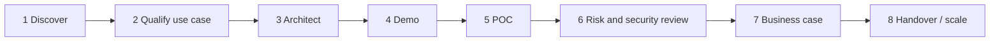

# 05 — Consultant Playbook (Outline)

> **Status: outline.** Sections below define the structure and key points. Full prose is tracked in [suggested issue #12](11-suggested-first-issues.md).

How to run an AI opportunity end to end, from first call to production handover, using the artifacts in [`templates/`](../templates/).

## Engagement lifecycle

## 1. Discover

- Goal: understand the business problem before talking about models.
- Use: [discovery questionnaire](../templates/discovery-questionnaire.md), [AI readiness assessment](../templates/ai-readiness-assessment.md).
- Key moves:
  1. Start with the process and its pain (time, cost, error rate, risk), not "AI".
  2. Map data sources, owners, sensitivity and access.
  3. Identify the decision-maker, the risk owner (CISO, DPO, legal) and the end user.
  4. Ask about existing AI use, including unsanctioned use ("shadow AI").
- Red flags: no measurable outcome; no data access; "we want an agent" with no process named.

## 2. Qualify the use case

- Use: [use-case assessment and prioritisation matrix](../templates/use-case-assessment.md).
- Classify: conversational AI, document AI, workflow automation, agentic AI.
- Score: value, feasibility, data readiness, risk, time to value.
- Rule of thumb: start with **high value, low autonomy** (assistive, human in the loop).

| Pattern | Typical first use case | Autonomy | Typical risk |
|---|---|---|---|
| Conversational AI | Internal IT/HR helpdesk | Low | Wrong answers, leakage |
| Document AI | Invoice / contract extraction | Low–medium | Extraction errors, PII |
| Workflow automation | Ticket/email triage | Medium | Misrouting |
| Agentic AI | Research, case handling | Medium–high | Excessive agency, cost |

## 3. Architect

- Use: [solution design one-pager](../templates/solution-design-one-pager.md), [reference architectures](../architectures/).
- Cover: data flow, model choice (local/cloud/hybrid), identity and access, guardrails, logging, human approval points, failure handling.

## 4. Demo

- Use: [demo script](../templates/demo-script.md), [07 — Demo and POC guide](07-demo-and-poc-guide.md).
- Show one persona, one problem, one "aha", one control (for example the approval step or a blocked injection).

## 5. POC

- Use: [POC plan](../templates/poc-plan.md).
- Agree success criteria **before** building. Measure quality, latency, cost, and safety on a fixed evaluation set.

## 6. Risk and security review

- Use: [risk register](../templates/risk-register.md), [security review checklist](../templates/security-review-checklist.md), [responsible AI checklist](../templates/responsible-ai-checklist.md), [06 — AI security playbook](06-ai-security-playbook.md).

## 7. Business case

- Use: [ROI / TCO outline](../templates/roi-tco-outline.md), [executive briefing](../templates/executive-briefing.md).
- Translate POC metrics into hours saved, error reduction, risk reduction and cost per transaction.

## 8. Handover and scale

- Production readiness: ownership, monitoring, evaluation cadence, incident response, model change management.
- Use: [customer QBR AI update](../templates/customer-qbr-ai-update.md) for ongoing value tracking.

## Objection handling

See [objection-handling guide](../templates/objection-handling-guide.md). Top five to prepare: data privacy, hallucination, cost unpredictability, security of agents, "we'll wait for the market to settle".

## To be written

- [ ] Worked example: IT helpdesk assistant from discovery to business case
- [ ] Talk tracks per persona (CIO, CISO, Head of Ops, end user)
- [ ] Mutual action plan template
- [ ] Pricing/licensing conversation guidance (without quoting vendor prices)
