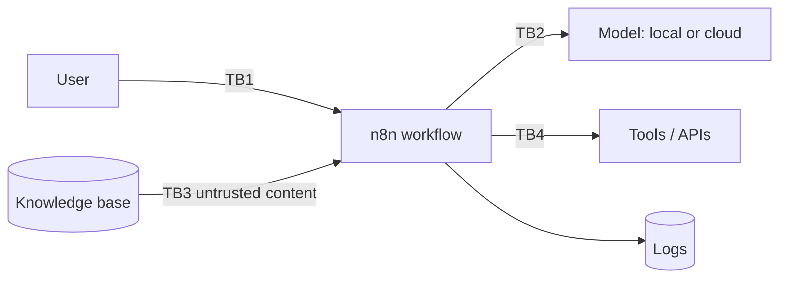

# 06 — AI Security Playbook (Outline)

> **Status: detailed outline.** Each section lists the points to cover, the controls to recommend, and where it is practised in the labs. Full prose is tracked in [suggested issue #13](11-suggested-first-issues.md).

This playbook helps you advise customers on securing LLM applications, RAG systems and agents, with n8n as the reference orchestration layer.

Key frameworks to reference (check for the latest versions):

- [OWASP Top 10 for LLM Applications](https://genai.owasp.org/llm-top-10/) (2025 list: LLM01 Prompt Injection, LLM02 Sensitive Information Disclosure, LLM03 Supply Chain, LLM04 Data and Model Poisoning, LLM05 Improper Output Handling, LLM06 Excessive Agency, LLM07 System Prompt Leakage, LLM08 Vector and Embedding Weaknesses, LLM09 Misinformation, LLM10 Unbounded Consumption)
- [MITRE ATLAS](https://atlas.mitre.org/) — adversary tactics and techniques against AI systems
- [NIST AI Risk Management Framework](https://www.nist.gov/itl/ai-risk-management-framework) and its Generative AI Profile

## 1. Threat modelling AI systems

- Map: users, prompts, system prompt, model, retrieval sources, tools/integrations, memory, logs, outputs, downstream consumers.
- Trust boundaries: user ↔ app, app ↔ model provider, retrieved content ↔ prompt, agent ↔ tools.
- Method: STRIDE (Spoofing, Tampering, Repudiation, Information disclosure, Denial of service, Elevation of privilege) per data flow, plus OWASP LLM risks per component.
- Practice: [Lab 11](../labs/lab-11-ai-security-red-team/README.md), [Module 12](../modules/12-ai-security-red-teaming/README.md).

## 2. Prompt injection

- **Direct:** the user tries to override instructions ("ignore previous instructions…").
- **Indirect:** instructions hidden in retrieved documents, emails, web pages or tool output.
- Reality check: there is no complete fix. Design so that a successful injection cannot do much harm.
- Controls: input screening, separating instructions from data (delimiters, structured prompts), least-privilege tools, human approval for consequential actions, output validation, monitoring.
- Practice: [Lab 10](../labs/lab-10-secure-rag-with-guardrails/README.md).

## 3. Sensitive data leakage

| Leak path | Example | Controls |
|---|---|---|
| Prompts | Users paste customer PII into a chatbot | DLP (data loss prevention)/redaction before the model, user guidance, approved tools |
| Retrieval | RAG returns documents the user is not entitled to | Document-level access control enforced at retrieval (metadata filters by role) |
| Logs | Prompts and outputs stored in execution history | Redact before logging, retention limits, access control on logs |
| Integrations | Agent sends data to a third-party API | Allow-listed tools, egress control |
| Third-party model APIs | Provider retention or training use | Contract terms, zero-retention options where offered, local models |

## 4. Excessive agency

- Too much functionality, permission or autonomy.
- Controls: minimal tool set, read-only by default, scoped credentials per tool, rate limits, approval gates, max iterations, audit logging of every tool call.
- Practice: [Lab 07](../labs/lab-07-n8n-single-agent-tool-use/README.md), [Lab 09](../labs/lab-09-n8n-human-in-the-loop-approval/README.md).

## 5. Improper (insecure) output handling

- Model output treated as trusted: rendered as HTML, used in SQL, shell, URLs or emails.
- Controls: treat output as untrusted input; schema validation; encoding/escaping; parameterised queries; never execute generated code without sandboxing.

## 6. Model, plugin, dependency and supply-chain risk

- Model provenance and licences; malicious model files (prefer safetensors formats); poisoned datasets.
- n8n community nodes and Python packages: vet, pin, scan.
- Container images: pin versions, scan, update regularly.

## 7. Data classification and redaction

- Classify data that may enter prompts, retrieval and logs (public / internal / confidential / restricted).
- Redact or tokenise PII before model calls where possible; Microsoft Presidio is an open-source option.

## 8. Least privilege and secrets

- Separate credentials per workflow and per tool; read-only where possible.
- n8n credentials or external secret manager; never secrets in prompts, workflow JSON or Git.
- Rotate keys; monitor usage.

## 9. Logging, monitoring and audit

- Log: who, what prompt (redacted), which documents, which tools, outputs (redacted), latency, tokens, cost, decision points, approvals.
- Alert on: injection patterns, policy blocks, cost spikes, unusual tool use.
- Practice: [Lab 12](../labs/lab-12-ai-observability-and-cost-dashboard/README.md).

## 10. Guardrails

- Input: length limits, injection heuristics/classifiers, PII detection, topic restrictions.
- Retrieval: entitlement filters, source allow-list, content sanitisation.
- Output: schema validation, citation checks, PII/secret scanning, toxicity checks, HTML escaping.
- Tools: allow-lists, parameter validation, approvals.
- Be explicit about **residual risk** — guardrails reduce, not eliminate.

## 11. Red-team test cases

- Categories: direct injection, indirect injection, jailbreak/role-play, system prompt extraction, data leakage, tool abuse, insecure output, denial of wallet (unbounded consumption).
- Severity: impact × likelihood, with clear definitions (see [risk register](../templates/risk-register.md)).

## 12. Incident response for AI

- Playbook additions: disable tool or workflow (n8n unpublish), rotate credentials, purge logs containing leaked data, notify per policy, re-run evaluation and red-team suites before re-enabling.

## 13. Vendor and model risk

- Questions: data retention, training on customer data, residency, subprocessors, security certifications, model change notifications, incident SLAs.

## 14. Residency, privacy, retention and compliance

- Where prompts, embeddings, logs and backups live; retention periods; data subject rights; Data Protection Impact Assessment (DPIA) triggers.
- Map to the customer's frameworks (for example GDPR, HIPAA, PCI DSS, SOC 2, ISO/IEC 27001, ISO/IEC 42001, EU AI Act). Not legal advice — involve the customer's counsel.

## 15. Secure AI reference architecture using n8n

See [architectures/secure-ai-reference-architecture.md](../architectures/secure-ai-reference-architecture.md).

## To be written

- [ ] Full prose for each section with customer talk tracks
- [ ] Control mapping table: OWASP LLM risk → control → n8n implementation → lab
- [ ] Sample AI incident runbook
