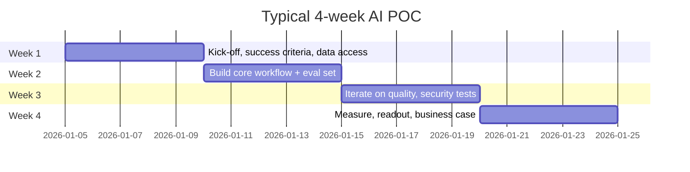

# 07 — Demo and POC Guide (Outline)

> **Status: outline.** Full content tracked in [suggested issue #14](11-suggested-first-issues.md).

## Demo principles

1. One persona, one painful task, one measurable improvement.
2. Show the **control**, not just the magic: citations, an approval step, a blocked injection, a cost log.
3. Use synthetic data that looks like the customer's world.
4. Have a recorded fallback and pinned data in n8n in case the model is slow.
5. Finish with "here is what a POC would prove" — not "any questions?".

## Demo catalogue (built in the labs)

| Demo | Lab | Audience | 60-second "aha" |
|---|---|---|---|
| Local LLM with structured output | [Lab 01](../labs/lab-01-local-llm-and-n8n-setup/README.md) | Technical | Free text → validated JSON, entirely local |
| Support chatbot with escalation | [Lab 03](../labs/lab-03-n8n-customer-support-chatbot/README.md) | Business + technical | Knows when to hand over to a human |
| RAG with citations | [Lab 04](../labs/lab-04-n8n-rag-knowledge-assistant/README.md) | Business | Answers from your docs, with sources, and says "I don't know" |
| Invoice extraction | [Lab 05](../labs/lab-05-n8n-document-intelligence-workflow/README.md) | Ops / finance | Low-confidence documents go to a human queue |
| Agent with approval | [Lab 07](../labs/lab-07-n8n-single-agent-tool-use/README.md), [Lab 09](../labs/lab-09-n8n-human-in-the-loop-approval/README.md) | CISO + ops | The agent cannot act without approval |
| Multi-agent research | [Lab 08](../labs/lab-08-n8n-multi-agent-research-assistant/README.md) | Exec | Report with confidence and limitations |
| Injection blocked | [Lab 10](../labs/lab-10-secure-rag-with-guardrails/README.md) | Security | Same attack, vulnerable vs hardened |

## Demo preparation checklist

- [ ] Stack up and models warm (send one request 5 minutes before)
- [ ] Workflows published; test webhooks replaced by production URLs
- [ ] Mailpit open in a tab
- [ ] Execution history cleared of earlier test noise
- [ ] Fallback recording ready
- [ ] Talk track printed ([demo script template](../templates/demo-script.md))

## POC structure

Use the [POC plan template](../templates/poc-plan.md).

## Success criteria examples

| Dimension | Example metric | Example target (agree with customer) |
|---|---|---|
| Quality | Answer correctness on golden set | ≥ 85% |
| Grounding | Answers with valid citation | ≥ 95% |
| Safety | Red-team cases blocked | 100% of critical, ≥ 90% overall |
| Latency | p95 response time | < 8 s |
| Cost | Cost per resolved query | Below current manual cost |
| Adoption | Pilot users active weekly | ≥ 70% |

## To be written

- [ ] Full demo talk tracks per lab
- [ ] POC readout deck outline
- [ ] Common POC failure patterns and how to avoid them
