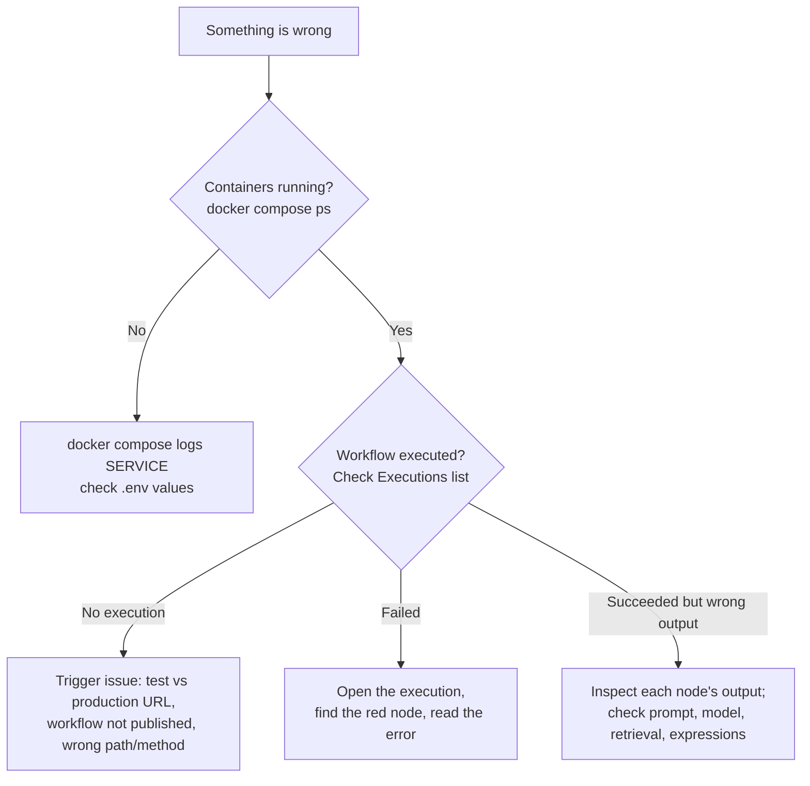

# 08 — Troubleshooting Guide

> **Status: starter.** Covers the most common issues across labs. Each module and lab also has its own troubleshooting section.

## Fast triage



## n8n issues

| Symptom | Cause | Fix |
|---|---|---|
| `404 The requested webhook "..." is not registered` | Using `/webhook/` while unpublished, or `/webhook-test/` without listening | Click **Execute workflow** then call `/webhook-test/...`, or publish and call `/webhook/...` |
| Webhook works once, then 404 | Test URLs accept one call per "listen" | Click **Execute workflow** again |
| Credential errors (`401`, "credentials not found") | Imported workflow has no credential selected | Open the node, select the credential, save |
| `ECONNREFUSED 127.0.0.1:11434` | `localhost` used inside Docker | Use container hostname `http://ollama:11434` |
| Expression shows `[undefined]` / "Can't get data for expression" | Wrong field path or node name; node not executed in this run | Check the input panel; use `$('Node Name').item.json...`; run upstream nodes |
| `$env` access denied | n8n 2.x blocks env access by default | Use the Config node or credentials (do not disable the protection) |
| "Access to the file is not allowed" | File outside allowed path | Use `/data/shared/...` (`./shared` on host) |
| Workflow timed out | Slow local model, agent looping | Increase timeout in Workflow settings; set agent Max Iterations; use smaller model |
| Out of memory / container killed | Model + n8n exceed RAM | Smaller model, close apps, raise Docker Desktop memory limit |
| Respond to Webhook never returns | Webhook **Respond** option not set to "Using 'Respond to Webhook' Node", or branch never reaches it | Fix Webhook setting; make sure every branch ends in a Respond node |

## Model and AI node issues

| Symptom | Cause | Fix |
|---|---|---|
| Agent never calls tools | Model lacks tool support, or tool descriptions are vague | Use `llama3.2`/`qwen2.5`; write clear tool names and descriptions |
| Output parser error "Failed to parse" | Model returned non-JSON or wrong schema | Lower temperature; simplify schema; enable auto-fix; add an example |
| Answers ignore the knowledge base | Retrieval empty or poor | Check Qdrant collection has points; same embedding model for ingest and query; raise topK |
| Qdrant "vector dimension error" | Embedding model changed | Delete and re-create the collection, re-ingest |
| Rate-limit (`429`) on cloud models | Provider limits | Retry with backoff (node Settings), batch, or use local model |
| Memory "forgets" | Different session ID each call, or window too small | Pass a stable `sessionId`; increase context window length |
| Memory lost after restart | Simple Memory is in-process | Use Postgres Chat Memory for durability |

## Docker issues

| Symptom | Fix |
|---|---|
| Port already allocated | Stop the other service or change the host port in `docker-compose.yml` |
| Changes to `.env` ignored | `docker compose up -d` recreates containers with new values (some values, like the encryption key, must never change after first start) |
| Postgres tables missing | Init SQL runs only on first volume creation: run `db/init/01-lab-schema.sql` manually with `psql`, or reset volumes |

```bash
docker compose exec -T postgres sh -c 'psql -U "$POSTGRES_USER" "$POSTGRES_DB"' < db/init/01-lab-schema.sql
```

## Python issues

| Symptom | Fix |
|---|---|
| `ModuleNotFoundError` | Activate `.venv`; `pip install -r requirements.txt` |
| `pytesseract.TesseractNotFoundError` | Install Tesseract and add it to PATH (Lab 05 only) |
| Connection refused to n8n webhook | Check URL (test vs production), workflow published, port 5678 |

## Getting more help

1. Search the [n8n community forum](https://community.n8n.io/).
2. Check [n8n docs](https://docs.n8n.io/) for the node.
3. Open a Lab issue with: n8n version, node, error text, execution screenshot (no secrets, no customer data).
