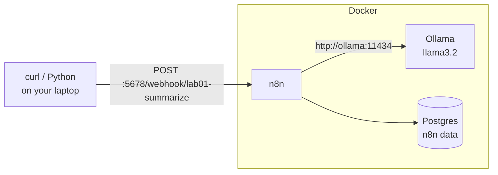
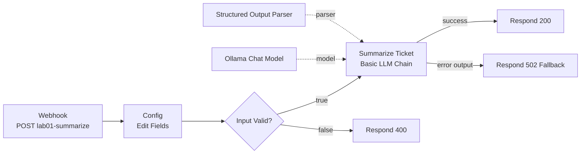

# Lab 01 — Local LLM and n8n Setup

| | |
|---|---|
| **Objective** | Run n8n + Ollama locally and build a webhook workflow that turns a free-text support ticket into validated JSON, with retries and a clean error path |
| **Module** | [01 — AI foundations](../../modules/01-ai-foundations/README.md) |
| **Estimated time** | 60–90 minutes (plus model download) |
| **Difficulty** | Beginner |
| **Prerequisites** | Docker Desktop/Engine, Git, Python 3.11+ (for the check script), 8 GB+ RAM |
| **Tools** | n8n (Open source, Local, Beginner-friendly) · Ollama + `llama3.2` (Open source, Local) · Postgres (Open source, Local) · Python + httpx (Open source, Local) |
| **Workflow** | [`n8n-workflows/01-basic-llm-workflow.json`](../../n8n-workflows/01-basic-llm-workflow.json) |

## Architecture



## n8n workflow



## Part A — Environment setup (30 min)

1. Follow [02 — Environment setup](../../docs/02-environment-setup.md) steps 1–6. In short:

   ```bash
   cp .env.example .env    # then replace every CHANGE_ME
   docker compose up -d
   docker compose logs -f ollama-init    # wait for both pulls to succeed, then Ctrl+C
   ```

2. Run the environment check (from the repo root, with your virtual env active):

   ```bash
   python labs/lab-01-local-llm-and-n8n-setup/check_env.py
   ```

   Expected:

   ```text
   [OK]   n8n health        http://localhost:5678/healthz
   [OK]   Ollama models     llama3.2, nomic-embed-text
   [OK]   Ollama generate   ... tokens in ... s
   [OK]   Qdrant            http://localhost:6333/collections
   ```

3. In n8n (http://localhost:5678) create the owner account, then the credential **Ollama** named `Ollama (local)` with Base URL `http://ollama:11434`. Click **Save**; n8n tests the connection.

## Part B — Import or build the workflow (30 min)

### Option 1: import (fast)

1. **Create workflow** → **⋯** → **Import from File…** → `n8n-workflows/01-basic-llm-workflow.json`.
2. Open **Ollama Chat Model** → select `Ollama (local)`. Save.

### Option 2: build it yourself (recommended once)

Build in this order. Node names matter because expressions refer to them.

| # | Node (UI name) | Rename to | Key settings | Why |
|---|---|---|---|---|
| 1 | **Webhook** | Webhook | HTTP Method `POST`; Path `lab01-summarize`; Respond `Using 'Respond to Webhook' Node` | Entry point; lets later nodes choose the HTTP status |
| 2 | **Edit Fields (Set)** | Config | Fields: `ticket_id` = `{{ $json.body.ticket_id \|\| 'unknown' }}`; `ticket_text` = `{{ ($json.body.ticket_text \|\| '').trim() }}`; `max_chars` (Number) = `8000`; `model` = `llama3.2` | One place for input mapping and limits; no hardcoding deeper in the flow |
| 3 | **IF** | Input Valid? | Condition (Boolean → is true): `{{ $json.ticket_text.length > 0 && $json.ticket_text.length <= $json.max_chars }}` | Rejects empty or oversized input before spending tokens (unbounded consumption control) |
| 4 | **Respond to Webhook** (false branch) | Respond 400 | Respond With `JSON`; body: see workflow file; Options → Response Code `400` | Clear client error |
| 5 | **Basic LLM Chain** (true branch) | Summarize Ticket | Source for Prompt: `Define below`; Prompt: ticket text inside `<<< >>>` delimiters; **Require Specific Output Format** on; add a **System** message (see file) | The model call. Delimiters separate data from instructions |
| 6 | **Ollama Chat Model** (sub-node of 5) | Ollama Chat Model | Credential `Ollama (local)`; Model `llama3.2`; Options → Sampling Temperature `0.1` | Low temperature for consistent structured output |
| 7 | **Structured Output Parser** (sub-node of 5) | Structured Output Parser | Schema Type `Define using JSON Schema`; schema with `summary`, `category` (enum), `priority` (enum incl. `unknown`), `needs_human` | Forces valid JSON; enums limit what the model can say |
| 8 | Summarize Ticket → **Settings** | — | **Retry On Fail** on, Max Tries `2`, Wait `2000` ms; **On Error** `Continue (using error output)` | Retries transient failures, then routes to a fallback instead of crashing |
| 9 | **Respond to Webhook** (success output) | Respond 200 | JSON body: `{{ JSON.stringify({ ticket_id: $('Config').item.json.ticket_id, model: $('Config').item.json.model, result: $json.output }) }}` | `$('Config')` reads an earlier node's data |
| 10 | **Respond to Webhook** (error output) | Respond 502 Fallback | Response Code `502`; body with `fallback` message | Graceful degradation |

**Expressions explained**

- `$json.body.ticket_text` — the Webhook node puts the POST body under `body`.
- `$('Config').item.json.ticket_id` — reads the item from the node named *Config* that is linked to the current item.
- `$json.output` — the Basic LLM Chain with an output parser returns the parsed object in `output`.

**Credentials:** only `Ollama (local)`. Nothing secret is in the workflow.

## Part C — Test (15 min)

1. In the editor click **Execute workflow** (the Webhook starts listening on the test URL).
2. Send a request:

   ```bash
   curl -s -X POST http://localhost:5678/webhook-test/lab01-summarize \
     -H "Content-Type: application/json" \
     -d '{"ticket_id":"T-1001","ticket_text":"Since this morning I cannot connect to the VPN from home. Error 809. I have a client demo at 2pm."}'
   ```

   PowerShell:

   ```powershell
   $body = @{ ticket_id = "T-1001"; ticket_text = "Since this morning I cannot connect to the VPN from home. Error 809. I have a client demo at 2pm." } | ConvertTo-Json
   Invoke-RestMethod -Method Post -Uri http://localhost:5678/webhook-test/lab01-summarize -ContentType "application/json" -Body $body
   ```

3. **Expected output** (wording varies):

   ```json
   {"ticket_id":"T-1001","model":"llama3.2","result":{"summary":"User cannot connect to VPN from home (error 809) before a 2pm client demo.","category":"network","priority":"high","needs_human":false}}
   ```

4. **Validation checklist**

   - [ ] Valid ticket → HTTP 200 with all four `result` fields and enum values only.
   - [ ] `{"ticket_text":""}` → HTTP 400.
   - [ ] `docker compose stop ollama`, resend → HTTP 502 fallback within ~10 s (then `docker compose start ollama`).
   - [ ] The execution appears in **Executions** with each node's input and output.
   - [ ] **Publish** the workflow and repeat step 2 with `/webhook/` instead of `/webhook-test/`.

## Security notes

- Synthetic tickets only. Execution history stores ticket text; in production, limit saved executions and redact.
- The prompt tells the model to ignore instructions inside the ticket, and the enum schema limits what an injected instruction can achieve. That reduces, not removes, prompt-injection risk.
- The webhook has no authentication — acceptable on `127.0.0.1` for a lab, not elsewhere. Add Header Auth for anything shared.

## Cost notes

Local model: no per-token charge; cost is your hardware and time. To compare with a cloud model, note `prompt_eval_count` and `eval_count` from the Python lab and multiply by the provider's current per-token prices.

## Common errors and fixes

| Error | Cause | Fix |
|---|---|---|
| Credential test fails / `ECONNREFUSED` | Base URL `http://localhost:11434` | Use `http://ollama:11434` |
| `404 webhook not registered` | Test URL without clicking Execute, or production URL while unpublished | Click **Execute workflow** for `/webhook-test/`; publish for `/webhook/` |
| Expression error `Cannot read properties of undefined (reading 'length')` | Body not JSON or wrong field name | Send `Content-Type: application/json`; check field `ticket_text` |
| "Failed to parse output" | Model returned invalid JSON | Lower temperature; keep schema small; enable **Auto-Fix Format** on the parser |
| Request hangs then times out | First model load or CPU-bound | Send a warm-up request; check `docker stats`; use a smaller model |
| Container killed / out of memory | RAM pressure | Raise Docker memory limit; close apps |
| `429` rate limit (cloud models only) | Provider limit | Keep Retry On Fail; add Wait Between Tries; batch |

## Stretch goals

1. Add a **Header Auth** credential to the Webhook and test with and without the header.
2. Add a `language` field to the schema and test with a ticket in another language.
3. Swap the Ollama model for `qwen2.5` (pull it first) and compare outputs on 5 tickets.
4. Log latency: add a Code node that records `Date.now()` before and after the chain.

## Cleanup

- Unpublish the workflow if you will not use it again.
- `docker compose stop` when finished for the day (data is kept).

## Customer demo

**What to show (5 minutes):**

1. A messy, realistic ticket going in, and clean JSON coming out — all on a laptop with no internet calls.
2. The enum fields: the model cannot invent a new priority level.
3. Stop the model and show the fallback: "the business process keeps working when AI doesn't."

**Business value talk track:**

> "Every ticket gets a consistent summary, category and priority in seconds. Your agents stop re-reading tickets, routing gets faster, and because the output is structured we can measure accuracy and plug it into your ITSM tool. It runs inside your environment, and when the model is unavailable the ticket simply goes to manual triage."

Next lab: [Lab 02 — Prompt engineering playground](../lab-02-prompt-engineering-playground/README.md).
