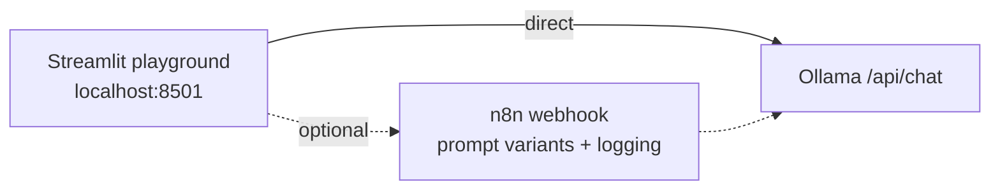

# Lab 02 — Prompt Engineering Playground

> **Status: outline + starter app.** The Streamlit starter below runs today. The n8n backend and full lab write-up are tracked in [suggested issue #4](../../docs/11-suggested-first-issues.md).

| | |
|---|---|
| **Objective** | Compare prompt patterns and temperatures side by side on a local model, and pick the variant that passes a small test set |
| **Module** | [02 — LLMs and prompting](../../modules/02-llms-and-prompting/README.md) |
| **Estimated time** | 60 minutes |
| **Difficulty** | Beginner |
| **Prerequisites** | [Lab 01](../lab-01-local-llm-and-n8n-setup/README.md) complete |
| **Tools** | Streamlit (Open source, Local, Beginner-friendly) · Ollama (Open source, Local) · n8n (optional backend) |

## Architecture



## Run the starter app

```bash
pip install -r requirements.txt
streamlit run labs/lab-02-prompt-engineering-playground/playground.py
```

Open http://localhost:8501. Paste an input (for example a support ticket), choose two prompt variants and temperatures, and compare outputs and latency.

## Planned lab structure

1. **Patterns:** zero-shot, few-shot, role + constraints, structured JSON, step-by-step decomposition.
2. **Experiment:** run each variant on the 10-example test set (`test-set.jsonl`, to be added) at temperatures 0, 0.5, 1.0.
3. **Measure:** format validity rate, correctness, latency, output tokens.
4. **n8n backend:** Webhook → Switch (variant) → Basic LLM Chain → Postgres log (reuse [workflow 01](../../n8n-workflows/01-basic-llm-workflow.json) as a base).
5. **Security:** test a prompt-injection input against each variant and compare robustness.

## Customer demo

Show one prompt failing on messy input, then the improved prompt passing — and explain that prompt changes are tested like code.
