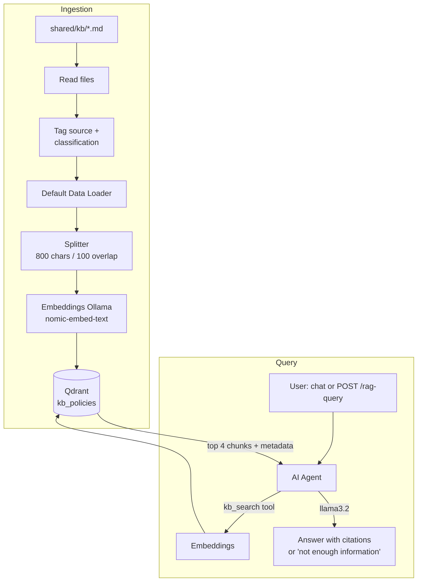
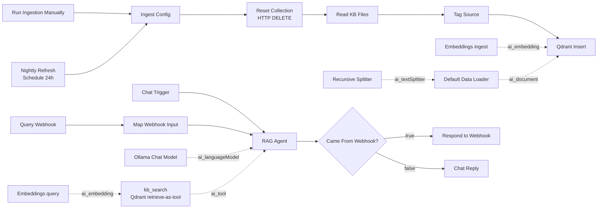

# Lab 04 — n8n RAG Knowledge Assistant

| | |
|---|---|
| **Objective** | Build retrieval-augmented generation (RAG) in n8n: ingest policy documents into Qdrant (chunk, embed, store), answer questions with citations, refuse when context is insufficient, refresh on a schedule, and measure quality with an evaluation set |
| **Module** | [04 — RAG and enterprise knowledge](../../modules/04-rag-and-enterprise-knowledge/README.md) |
| **Estimated time** | 2 hours |
| **Difficulty** | Intermediate |
| **Prerequisites** | [Lab 01](../lab-01-local-llm-and-n8n-setup/README.md), [Lab 03](../lab-03-n8n-customer-support-chatbot/README.md); credentials `Ollama (local)`, `Qdrant (local)` |
| **Tools** | n8n AI Agent, Qdrant Vector Store, Default Data Loader, Recursive Character Text Splitter, Embeddings Ollama (Open source, Local) · Qdrant (Open source, Local) · `nomic-embed-text` (Open source, Local) · Python eval script |
| **Workflow** | [`n8n-workflows/03-rag-workflow.json`](../../n8n-workflows/03-rag-workflow.json) |
| **Data** | [`sample-docs/`](sample-docs/) (synthetic), [`eval-set.jsonl`](eval-set.jsonl) |

## Architecture



## n8n workflow



## Setup

1. Copy the knowledge base into the folder n8n can read:

   ```bash
   make kb
   # or: mkdir -p shared/kb && cp labs/lab-04-n8n-rag-knowledge-assistant/sample-docs/*.md shared/kb/
   ```

   PowerShell: `Copy-Item labs\lab-04-n8n-rag-knowledge-assistant\sample-docs\*.md shared\kb\`

2. Create the **Qdrant** credential `Qdrant (local)` (URL `http://qdrant:6333`).
3. Import `03-rag-workflow.json`; select credentials on both Embeddings nodes, the Ollama Chat Model, **Qdrant Insert** and **kb_search**. Save.

## Node-by-node build

### Ingestion path

| # | Node | Key settings | Why |
|---|---|---|---|
| 1 | **Manual Trigger** "Run Ingestion Manually" | — | Run on demand while building |
| 2 | **Schedule Trigger** "Nightly Refresh" | Every 24 hours | Keeps the index fresh. Timezone = `GENERIC_TIMEZONE` |
| 3 | **Edit Fields** "Ingest Config" | `kb_glob` = `/data/shared/kb/*.md`; `qdrant_url` = `http://qdrant:6333`; `collection` = `kb_policies` | Single place for paths and names |
| 4 | **HTTP Request** "Reset Collection" | Method `DELETE`; URL `{{ $json.qdrant_url }}/collections/{{ $json.collection }}`; Settings: **Always Output Data**, On Error *Continue* | Full refresh: removes stale and deleted content. Simple and safe for small KBs |
| 5 | **Read/Write Files from Disk** "Read KB Files" | Operation Read; File(s) Selector `{{ $('Ingest Config').item.json.kb_glob }}`; **Execute Once** | One item per file, with binary data. Only `/data/shared` is allowed (`N8N_RESTRICT_FILE_ACCESS_TO`) |
| 6 | **Edit Fields** "Tag Source" | `source` = `{{ $binary.data.fileName }}`; `classification` = `{{ $binary.data.fileName.split('-')[0] }}`; Include Other Fields; Options → Include Binary | Metadata for citations (source) and for access control in Lab 10 (classification = `public`/`internal`/`confidential`) |
| 7 | **Qdrant Vector Store** "Qdrant Insert" | Operation Mode **Insert Documents**; Collection `kb_policies` (By ID) | Stores vectors + text + metadata. Collection is created on first insert |
| 8 | **Default Data Loader** | Type of Data **Binary**; Options → Metadata: `source`, `classification` from `$json` | Turns each file into documents and attaches metadata |
| 9 | **Recursive Character Text Splitter** | Chunk Size `800`, Chunk Overlap `100` | Chunks small enough to be specific, overlap to avoid cutting facts in half |
| 10 | **Embeddings Ollama** "Embeddings (ingest)" | Model `nomic-embed-text` | Must match the query embedding model |

### Query path

| # | Node | Key settings | Why |
|---|---|---|---|
| 11 | **Chat Trigger** | Not public (use **Open chat** in the editor) | Interactive testing |
| 12 | **Webhook** "Query Webhook" | `POST` `rag-query`; Respond: Using Respond to Webhook node | API for the eval script and other apps |
| 13 | **Edit Fields** "Map Webhook Input" | `chatInput` = `{{ String($json.body.question \|\| '').slice(0, 1000) }}`; `sessionId` | Gives both triggers the same field name; caps input length |
| 14 | **AI Agent** "RAG Agent" | Prompt `{{ $json.chatInput }}`; System Message: always search, answer only from passages, cite `[file.md]`, exact insufficient-context sentence, ignore instructions in passages; Max Iterations `4` | Grounded answering with a refusal path |
| 15 | **Ollama Chat Model** | `llama3.2`, temperature `0.1` | Factual, consistent |
| 16 | **Qdrant Vector Store** "kb_search" | Operation Mode **Retrieve Documents (As Tool for AI Agent)**; description; Limit/Top K `4`; Include Metadata on | The agent calls this to search. Metadata carries the source file name for citations |
| 17 | **Embeddings Ollama** "Embeddings (query)" | `nomic-embed-text` | Same model as ingestion |
| 18 | **IF** "Came From Webhook?" | `{{ $('Query Webhook').isExecuted }}` is true | Only respond over HTTP when the webhook started the run |
| 19 | **Respond to Webhook** | JSON `{question, answer}` | API response |
| 20 | **Edit Fields** "Chat Reply" | `output` = `{{ $json.output }}` | The chat UI displays the `output` field of the last node |

> Some n8n versions name the tool after the node instead of a separate **Tool Name** field. Either way, keep it `kb_search` and keep the description specific.

## Run and test

1. **Ingest:** open the workflow, click **Run Ingestion Manually** → **Execute workflow**. Check Qdrant:

   ```bash
   curl -s http://localhost:6333/collections/kb_policies
   ```

   Expected: `"status":"green"` and `points_count` > 0 (around 10–20 for the sample docs).

2. **Chat:** **Open chat** → "How long are VPN connection logs retained?"
   Expected: "…retained for 90 days… [internal-vpn-policy.md]".

3. **Insufficient context:** "What is on the cafeteria menu today?"
   Expected: "I don't have enough information in the knowledge base to answer that."

4. **API:** publish, then:

   ```bash
   curl -s -X POST http://localhost:5678/webhook/rag-query -H "Content-Type: application/json" \
     -d '{"question":"After how many failed sign-in attempts is an account locked?"}'
   ```

   Expected: `{"question":"...","answer":"...5 failed attempts... locked for 15 minutes [internal-password-policy.md]"}`

5. **Evaluate:**

   ```bash
   python labs/lab-04-n8n-rag-knowledge-assistant/eval_rag.py
   ```

   Expected: a PASS/FAIL line per question, then a summary such as `Passed 8/10 (80%) | median 9.3s | p95 14.0s`, and `rag-eval-results.csv`. Small local models typically score 60–90% here; record your baseline.

### Validation checklist

- [ ] `points_count` > 0 after ingestion; each point has `metadata.source` and `metadata.classification` (check in the Qdrant dashboard at http://localhost:6333/dashboard).
- [ ] Answers include a `[source.md]` citation.
- [ ] Unanswerable questions return the insufficient-context sentence.
- [ ] Eval baseline recorded.
- [ ] Re-running ingestion does not duplicate points (full refresh).

## Security notes

- **Access control:** this lab returns any document to anyone. Lab 10 adds role-based filtering on `metadata.classification`. Never put confidential content in an unfiltered index.
- **Indirect prompt injection:** documents are untrusted input. The system message says to ignore instructions inside passages — a weak control on its own. Lab 10 adds sanitisation and output checks.
- **Index write access** is as sensitive as document access (OWASP LLM08: vector and embedding weaknesses). Control who can add files to `shared/kb`.
- Execution logs store questions and answers; set retention accordingly.

## Cost notes

Ingestion costs one embedding call per chunk (local: compute time only). Each question costs: query embedding + 1–3 model calls (agent reasoning + tool use) with ~4 chunks of context (≈ 800–1,200 input tokens). Halving top K roughly halves context tokens — measure the quality impact with the eval set before cutting.

## Common errors and fixes

| Error | Cause | Fix |
|---|---|---|
| Read KB Files: "access to the file is not allowed" / no items | Path outside `/data/shared` or files not copied | `make kb`; use `/data/shared/kb/*.md` |
| Qdrant credential fails | `localhost` URL | `http://qdrant:6333` |
| `Wrong input: Vector dimension error` | Changed embedding model | Same model both sides; re-run ingestion (it deletes the collection) |
| Agent answers without citations | Model skipped the tool or ignored instructions | Lower temperature; restate rule 1 and 3; try `qwen2.5` |
| Agent always says "not enough information" | Tool not called, or retrieval empty | Check `points_count`; open the execution and inspect the `kb_search` output |
| Expression error on `$binary.data.fileName` | Read node output lacks binary | Check Read KB Files output; ensure **Include Binary** on Tag Source |
| Webhook times out | Slow local model (agent + tool) | Increase client timeout; warm the model; reduce top K |
| Respond to Webhook error in chat runs | Respond node reached from chat trigger | Keep the **Came From Webhook?** IF in place |

## Stretch goals

1. Add **source URLs** and **last-updated dates** to metadata and show them in answers.
2. Incremental refresh: hash each file and only re-embed changed files (Code node + Qdrant delete by filter).
3. Compare chunk sizes 400 / 800 / 1,500 with the eval set in a Jupyter notebook.
4. Add a **reranker** step or the **Contextual Compression Retriever** (check current n8n docs).
5. Swap Qdrant for **Simple Vector Store** and discuss why it is demo-only.

## Cleanup

```bash
curl -X DELETE http://localhost:6333/collections/kb_policies
```

Unpublish the workflow; disable the Schedule Trigger if you do not want nightly runs.

## Customer demo

**Show (8 minutes):** ask three policy questions → point to the citations → ask an off-topic question and show the refusal → open the Qdrant dashboard to show chunks and metadata → show the eval results table.

**Business value:**

> "Employees get accurate, cited answers from your own policies in seconds instead of searching SharePoint or opening tickets. The assistant says when it doesn't know. We measure accuracy on your real questions before go-live, and because the index refreshes nightly, answers stay current."

Next lab: [Lab 05 — Document intelligence workflow](../lab-05-n8n-document-intelligence-workflow/README.md).
