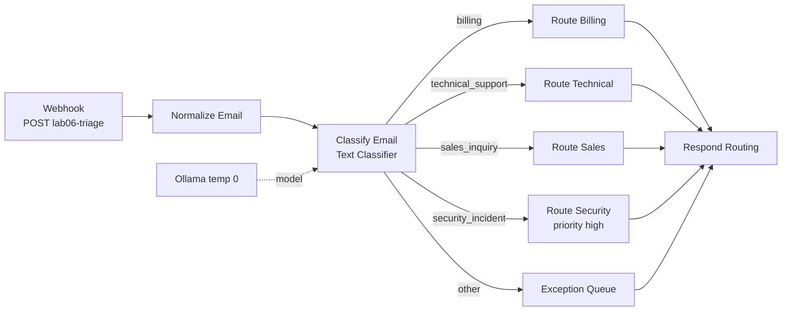

# Lab 06 — n8n Email Triage Agent

> **Status: outline — workflow ready.** The workflow imports and runs today; the full lab write-up (IMAP variant, retries, exception queue handling, error workflow) is tracked in [suggested issue #7](../../docs/11-suggested-first-issues.md).

| | |
|---|---|
| **Objective** | Classify inbound emails and route them to the right queue, with an exception queue for anything unclear |
| **Module** | [05 — AI workflows with n8n](../../modules/05-ai-workflows-with-n8n/README.md) |
| **Estimated time** | 60–90 minutes |
| **Difficulty** | Beginner–Intermediate |
| **Prerequisites** | [Lab 01](../lab-01-local-llm-and-n8n-setup/README.md); `Ollama (local)` |
| **Tools** | n8n Text Classifier, Edit Fields, Webhook (Open source, Local) · Ollama (Open source, Local) · Email Trigger (IMAP) + Mailpit (Optional) |
| **Workflow** | [`n8n-workflows/05-email-triage-agent.json`](../../n8n-workflows/05-email-triage-agent.json) |

## Workflow



## Quick test

```bash
curl -s -X POST http://localhost:5678/webhook-test/lab06-triage -H "Content-Type: application/json" \
  -d '{"from":"customer@example.test","subject":"Invoice 4471 charged twice","body":"We were billed twice this month. Please refund the duplicate."}'
```

Expected: `{"category":"billing","queue":"finance-ar","priority":"normal",...}`

More test emails to try: a VPN outage complaint (technical), a request for a quote for 200 more licences (sales), "I think my account was hacked" (security, high), "Hello?" (other → exception queue).

## Planned sections

1. Node-by-node build, including how category descriptions drive classification quality.
2. Production variant: **Email Trigger (IMAP)** reading a Mailpit/test mailbox; least-privilege mailbox credential.
3. Reliability: Retry On Fail, idempotency (message-ID de-duplication), Error Trigger workflow ([workflow 10](../../n8n-workflows/10-observability-workflow.json)).
4. Exception queue handling and human feedback loop to improve category descriptions.
5. Evaluation: 50 synthetic emails, confusion matrix (Python).
6. Integrations: ticketing (Jira/ServiceNow/Zendesk), CRM, Slack/Teams notifications — sandbox/free options where available (check current terms).
7. Security: injection in email bodies cannot change the fixed label set; no free-form actions.
8. Customer demo and business value.
