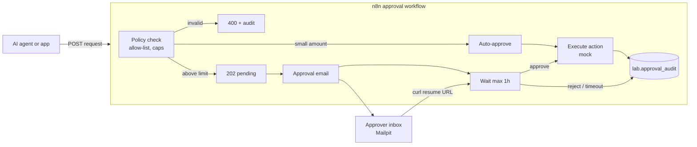
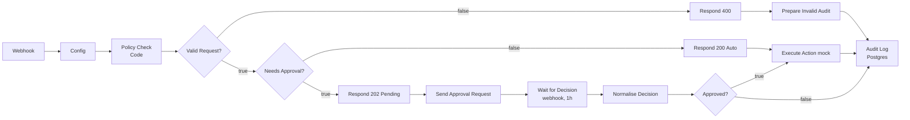

# Lab 09 — n8n Human-in-the-Loop Approval

| | |
|---|---|
| **Objective** | Gate a sensitive action (issuing a service credit) behind a deterministic policy check and a human approval with timeout, and audit every decision |
| **Module** | [05 — AI workflows with n8n](../../modules/05-ai-workflows-with-n8n/README.md) (also used by [Module 07](../../modules/07-single-agent-systems/README.md)) |
| **Estimated time** | 90 minutes |
| **Difficulty** | Intermediate |
| **Prerequisites** | [Lab 01](../lab-01-local-llm-and-n8n-setup/README.md); credentials `Postgres (lab)`, `SMTP (Mailpit)` |
| **Tools** | n8n Webhook, Code, IF, Wait, Send Email, Postgres, Respond to Webhook (Open source, Local) · Mailpit (Open source, Local) · Postgres (Open source, Local) |
| **Workflow** | [`n8n-workflows/08-human-approval-workflow.json`](../../n8n-workflows/08-human-approval-workflow.json) |

> No model is involved in the approval decision. That is the point: an AI (for example the Lab 07 agent) can **request** an action; deterministic policy and a person **decide**.

## Architecture



## n8n workflow



## Setup

Import `08-human-approval-workflow.json`; select `Postgres (lab)` on **Audit Log** and `SMTP (Mailpit)` on **Send Approval Request**. Save and **publish** (Wait resume URLs are for published workflows).

## Node-by-node build

| # | Node | Key settings | Why |
|---|---|---|---|
| 1 | **Webhook** | `POST` `lab09-request`; Respond via node | The caller gets 200/202/400 straight away |
| 2 | **Edit Fields** "Config" | `auto_approve_limit_usd` 100; `hard_cap_usd` 10,000; `allowed_actions` (comma list); `approver_email` | Policy as configuration, reviewable by the risk owner |
| 3 | **Code** "Policy Check" | Validates request ID, action allow-list, amount range; outputs `decision` = `invalid` / `auto` / `needs_approval`; truncates all strings | Deterministic, testable policy. Never let a model decide its own permissions |
| 4 | **IF** "Valid Request?" → **Respond 400** → **Code** "Prepare Invalid Audit" | — | Invalid requests are rejected **and** audited |
| 5 | **IF** "Needs Approval?" | `decision == needs_approval` | Risk-based routing: low value flows straight through |
| 6 | **Respond to Webhook** "Respond 200 Auto" / "Respond 202 Pending" | Status codes 200 / 202 | The Respond node returns the HTTP response and the workflow continues |
| 7 | **Send Email** "Send Approval Request" | Request details + approve/reject `curl` commands with `{{ $execution.resumeUrl }}` | Out-of-band approval channel |
| 8 | **Wait** "Wait for Decision" | Resume **On Webhook Call**, `POST`; Limit Wait Time 1 hour | Pauses safely; times out instead of waiting forever |
| 9 | **Code** "Normalise Decision" | `approve` → approved; `reject` → rejected; no body → `timed_out`; records approver and notes | Explicit handling of every outcome |
| 10 | **IF** "Approved?" → **Code** "Execute Action (mock)" | Mock action with timestamp | Replace with the real system call using a narrowly scoped credential |
| 11 | **Postgres** "Audit Log" | Parameterised `INSERT INTO lab.approval_audit` | One audit trail for every path |

## Run and test

1. **Auto-approve path** (amount ≤ 100):

   ```bash
   curl -s -X POST http://localhost:5678/webhook/lab09-request -H "Content-Type: application/json" \
     -d '{"request_id":"REQ-1001","action":"issue_service_credit","account_id":"ACME-001","amount":50,"requested_by":"agent:lab07","reason":"Short VPN outage"}'
   ```

   Expected: `{"request_id":"REQ-1001","status":"auto_approved"}` (HTTP 200).

2. **Approval path** (amount 250):

   ```bash
   curl -s -X POST http://localhost:5678/webhook/lab09-request -H "Content-Type: application/json" \
     -d '{"request_id":"REQ-1002","action":"issue_service_credit","account_id":"ACME-001","amount":250,"requested_by":"agent:lab07","reason":"Extended VPN outage"}'
   ```

   Expected: HTTP 202 `pending_approval`. Open Mailpit → copy the **Approve** command → run it. The execution resumes, executes the mock action and audits `approved`.

3. **Reject path:** repeat with `REQ-1003` and run the **Reject** command. Expected audit: `rejected`.
4. **Invalid:** `"action":"delete_account"` or `"amount":-5`. Expected: HTTP 400 with `reasons`; audit `rejected` by `policy`.
5. **Timeout (optional):** temporarily set Limit Wait Time to 1 minute, send a request, do nothing. Expected audit: `timed_out`.

Check the audit trail:

```bash
docker compose exec postgres sh -c 'psql -U "$POSTGRES_USER" "$POSTGRES_DB" -c "select request_id, decision, decided_by, notes from lab.approval_audit order by id desc limit 10;"'
```

### Validation checklist

- [ ] All five paths produce the expected HTTP status and audit row.
- [ ] Approver name and notes are recorded.
- [ ] Calling the same resume URL twice does not execute the action twice (the second call fails because the execution has already resumed).

## Security notes

- **Resume URLs are bearer tokens.** Anyone holding one can approve. For production: authenticate approvers (SSO-protected approval app, n8n form with authentication, or chat-ops tools with identity), and record who approved.
- Segregation of duties: the requester must not be able to approve their own request — enforce by comparing `requested_by` with the approver identity.
- Approval emails contain request details; avoid personal data.
- The executing credential should allow only this action, with its own limits.

## Cost notes

No model calls in this workflow. Waiting executions are stored in the database and do not consume CPU while waiting.

## Common errors and fixes

| Error | Cause | Fix |
|---|---|---|
| Resume call returns 404 / "execution not waiting" | Already resumed or timed out; workflow not published | Start a new request; publish |
| Email has an empty resume URL | Workflow run in test mode, or expression typo | Publish and use the production webhook URL |
| Audit insert fails on `decision` check constraint | Unexpected decision value | Keep values to `auto_approved`/`approved`/`rejected`/`timed_out` |
| `curl` command breaks on Windows CMD | Quote handling | Use Git Bash or the PowerShell `Invoke-RestMethod` form |
| Caller receives nothing | Respond node not reached | Every path must pass a Respond to Webhook node before long waits |

## Stretch goals

1. Use the Wait node's **On Form Submitted** resume option to give approvers a simple form instead of `curl` (check current docs).
2. Send approvals to Slack or Microsoft Teams with buttons ("Send and Wait for Response" operations exist on several n8n app nodes — check current docs).
3. Call this workflow from the Lab 07 agent's restricted tool.
4. Add segregation-of-duties checks.

## Cleanup

`TRUNCATE lab.approval_audit;` and stop waiting executions from **Executions**.

## Customer demo

**Show (6 minutes):** a small request auto-approved → a larger request generating an approval email → approve from the email → the audit table showing who approved what and when.

**Business value:**

> "AI can prepare and request actions, but policy and people decide. Low-risk requests flow through instantly; high-value ones go to the right approver with full context and expire if ignored. Every decision is auditable, which is exactly what your auditors and CISO will ask for."

Next lab: [Lab 10 — Secure RAG with guardrails](../lab-10-secure-rag-with-guardrails/README.md).
