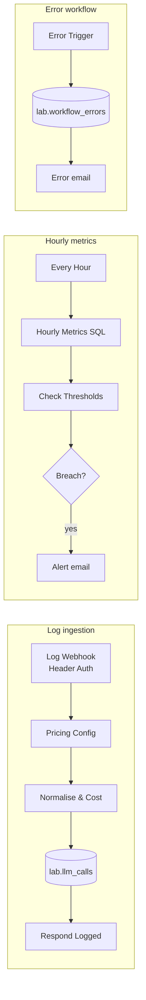

# Lab 12 — AI Observability and Cost Dashboard

> **Status: outline — workflow ready.** The workflow imports and runs today; the golden-dataset evaluation workflow and dashboard write-up are tracked in [suggested issue #11](../../docs/11-suggested-first-issues.md).

| | |
|---|---|
| **Objective** | Log every LLM call (tokens, latency, cost, status, feedback), compute hourly metrics with alerts, capture workflow errors, and evaluate against a golden dataset |
| **Module** | [10 — AI observability and evaluation](../../modules/10-ai-observability-and-evaluation/README.md) |
| **Estimated time** | 2 hours |
| **Difficulty** | Intermediate |
| **Prerequisites** | Labs 01 and 04; credentials `Postgres (lab)`, `SMTP (Mailpit)`, `Header Auth (lab)` |
| **Tools** | n8n Webhook, Schedule Trigger, Error Trigger, Postgres, Send Email (Open source, Local) · Postgres (Open source, Local) · Optional: Grafana, Metabase (Open source, Local, Optional), Langfuse (Open source core, Optional) |
| **Workflow** | [`n8n-workflows/10-observability-workflow.json`](../../n8n-workflows/10-observability-workflow.json) |

## Workflow



## Quick test

```bash
curl -s -X POST http://localhost:5678/webhook/ai-log -H "X-Lab-Key: $LAB_KEY" -H "Content-Type: application/json" \
  -d '{"workflow":"lab04-rag","execution_id":"123","model":"llama3.2","prompt_tokens":812,"completion_tokens":143,"latency_ms":6400,"status":"ok","user_feedback":1}'
```

Expected: `{"logged":true,"id":1}`. Then run **Every Hour** manually; lower thresholds in **Check Thresholds** to see an alert in Mailpit.

Set this workflow as the **Error workflow** (Workflow → Settings) of workflows 01–09 to capture failures.

## Planned sections

1. Instrumenting workflows: an HTTP Request node at the end of each workflow posting telemetry (tokens from the model response where available — check what each node exposes; latency from timestamps).
2. Golden dataset evaluation workflow: read `eval-set.jsonl` cases, call the target, score, write results to a `lab.eval_runs` table.
3. Metrics: quality (pass rate), grounding (citation rate), safety (blocked rate), latency p50/p95, tokens and cost per request, user feedback.
4. Dashboard: SQL views + Grafana or Metabase (optional), or a Streamlit page.
5. Alert design: thresholds agreed in the POC plan; routing to owners.
6. Privacy: no raw prompts in telemetry by default; redacted samples only.
7. Customer demo: the POC readout built from these numbers.
