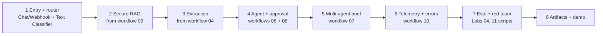

# Lab 13 — Capstone: Secure AI Advisor

The full specification, requirements, deliverables and scoring rubric are in **[Module 14 — Capstone](../../modules/14-capstone-secure-enterprise-ai-advisor/README.md)**. This page is the build guide.

| | |
|---|---|
| **Objective** | Build and present a Secure Enterprise Knowledge and Workflow Assistant with the full consultant artifact pack |
| **Estimated time** | 8–20 hours |
| **Difficulty** | Advanced |
| **Prerequisites** | Labs 01–12 |
| **Tools** | Everything in the program; n8n is the orchestration layer |

## Build order (reuse, don't rebuild)

| Step | Reuse | What to add |
|---|---|---|
| 1 | Workflow 05 pattern | Router categories: policy_question, incident_report, account_task, research |
| 2 | Workflow 09 | Call it as a sub-workflow (Execute Workflow / Call n8n Sub-Workflow Tool) |
| 3 | Workflow 04 | Incident-report schema instead of invoice |
| 4 | Workflows 06 + 08 | Restricted tool calls the approval workflow |
| 5 | Workflow 07 | Trigger from the router; keep the human review |
| 6 | Workflow 10 | Every branch posts telemetry; error workflow set everywhere |
| 7 | `eval_rag.py`, `red_team_runner.py` | 25+ eval cases; red team against the capstone entry point |
| 8 | Templates | All deliverables D1–D11 |

## Checkpoints

- [ ] Day 1: architecture + threat model drafted; router works
- [ ] Day 2: secure RAG answers with citations through the router
- [ ] Day 3: agent + approval + extraction working
- [ ] Day 4: multi-agent + telemetry + error workflow
- [ ] Day 5: eval ≥ 25 cases; red-team run; fixes
- [ ] Day 6: artifacts complete; demo rehearsed twice (technical and executive versions)

## Submission

Create a private fork or branch with: exported workflows (no credentials), eval and red-team CSVs, the artifact pack, and a 10-minute demo recording. Open a **Learning progress** issue titled "Capstone submission" linking to them.
