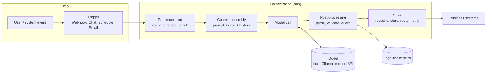
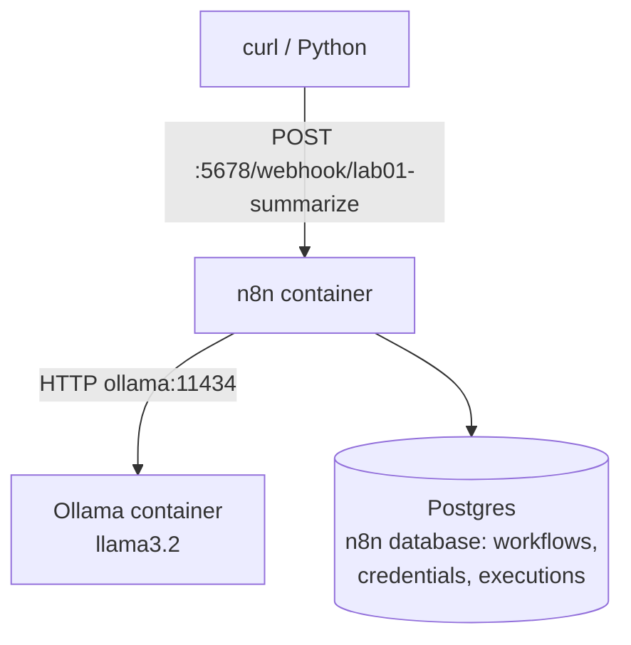

# Module 01 — Architecture: Anatomy of an LLM Application

Every AI solution in this program is a variation of one shape: a **trigger**, some **context**, a **model call**, **validation**, and an **action**, wrapped in **controls**.

## Logical architecture

## Lab 01 physical architecture

## Where each concept lives

| Concept | Layer | Design decision |
|---|---|---|
| Tokens / cost | Context assembly, model call | How much context to send; which model |
| Context window | Context assembly | Truncate, summarise or retrieve selectively |
| Temperature | Model call | Low for structured tasks |
| Hallucination | Context + post-processing | Ground, allow "unknown", validate |
| Latency | Model call | Model size, hardware, streaming |
| Security | Pre/post-processing, logs | Redaction, guardrails, log hygiene |

## Deployment options at a glance

| Option | When | Covered in |
|---|---|---|
| All local (laptop / on-prem) | Sensitive data, POC, no cloud approval | This module, Module 09 |
| Cloud model, self-hosted n8n | Need frontier quality, data allowed to leave | Module 09 |
| Hybrid routing | Sensitive → local, general → cloud | [Hybrid architecture](../../architectures/hybrid-cloud-local-ai.md) |

## Whiteboard exercise

Draw the logical architecture above for a customer's "summarise every inbound support ticket" idea. Mark: where data enters, where it leaves your trust boundary, where you validate, and where a human could intervene.
