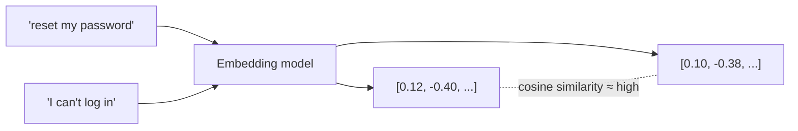

# Module 01 — Concepts

## 1. AI, ML, generative AI and LLMs

| Term | Plain English | Example |
|---|---|---|
| **Artificial intelligence (AI)** | Software that performs tasks we associate with human judgement | Spam filtering, route planning |
| **Machine learning (ML)** | AI that learns patterns from data rather than following hand-written rules | Fraud scoring |
| **Generative AI** | ML that produces new content: text, images, code, audio | Drafting an email |
| **Large language model (LLM)** | A generative model trained on large amounts of text to predict the next token | Llama, GPT, Claude, Gemini, Mistral |

An LLM does one thing: given text so far, it predicts likely next tokens. Everything else — chat, summarisation, extraction, tool use — is built on top of that.

## 2. Tokens

A **token** is a chunk of text the model reads and writes. In English, one token is roughly ¾ of a word (100 tokens ≈ 75 words), but it varies by language and model.

Why SCs care:

| Tokens drive… | Because… |
|---|---|
| **Cost** | Cloud providers price per input and output token (check current pricing) |
| **Limits** | Context windows are measured in tokens |
| **Latency** | Output tokens are generated one at a time; long answers take longer |

You will see token counts from Ollama in the [Python lab](python-lab.md) (`prompt_eval_count` and `eval_count`).

## 3. Embeddings

An **embedding** turns text into a list of numbers (a vector) that captures meaning. Texts with similar meaning have vectors that are close together, even with no words in common ("reset my password" ≈ "I can't log in").

Embeddings power **semantic search** and **RAG** (retrieval-augmented generation, Module 04). They are produced by separate, smaller embedding models (this repo uses `nomic-embed-text`).



## 4. Context window

The **context window** is the maximum number of tokens the model can consider at once: system prompt + conversation history + retrieved documents + the answer.

- Exceed it and input is truncated (often silently) or the request fails.
- Bigger windows cost more per call and can dilute attention ("lost in the middle").
- Ollama defaults to a small context (`num_ctx`); you can raise it in the **Ollama Chat Model** node options (uses more RAM).

## 5. Temperature and sampling

**Temperature** controls randomness when picking the next token.

| Setting | Behaviour | Use for |
|---|---|---|
| 0–0.2 | Consistent, conservative | Extraction, classification, structured JSON |
| 0.3–0.7 | Balanced | Q&A, summaries |
| 0.8+ | Creative, varied | Brainstorming, marketing drafts |

Even at temperature 0, outputs can vary slightly between runs and model versions. Do not promise determinism.

## 6. Hallucination

A **hallucination** is a fluent, confident answer that is wrong or unsupported. It happens because the model generates *plausible* text, not *verified* text.

Reduce it by:

1. **Grounding** — give the model the source text (RAG) and require citations.
2. **Permission to abstain** — instruct it to say "I don't know" when the context is insufficient.
3. **Structure and validation** — constrain output to a schema and validate it in code.
4. **Low temperature** for factual tasks.
5. **Human review** where the impact of an error is high.
6. **Evaluation** — measure hallucination rate on a test set (Module 10).

## 7. Prompting basics

A good prompt has: **role**, **task**, **context**, **constraints**, **output format**, and optionally **examples**.

```text
Role: You are an IT service desk analyst.
Task: Summarise the ticket and classify its priority.
Context: <ticket text>
Constraints: Use only the ticket text. If priority is unclear, use "unknown".
Output: JSON with keys summary (string, max 30 words), priority (low|medium|high|unknown).
```

Module 02 goes deeper.

## 8. Cost and latency

| Driver | Effect | Lever |
|---|---|---|
| Model size | Bigger = better reasoning, slower, costlier | Use the smallest model that passes your eval |
| Input tokens | Long prompts and big retrievals cost more | Trim context, retrieve fewer, better chunks |
| Output tokens | Long answers are slow | Ask for concise, structured output |
| Calls per task | Agents may call the model many times | Cap iterations; use workflows where steps are known |
| Hardware (local) | CPU-only is slow | GPU, smaller/quantised models |

## 9. Local vs cloud models

| | Local (e.g. Ollama) | Cloud API |
|---|---|---|
| Data location | Stays in your environment | Sent to provider (check retention/terms) |
| Quality | Good for focused tasks with smaller models | Frontier reasoning, long context |
| Cost model | Hardware + operations | Per token |
| Latency | Depends on your hardware | Network + provider load |
| Operations | You patch, scale and monitor | Provider manages |

## 10. Use-case categories

| Category | Pattern | First question to ask |
|---|---|---|
| Conversational AI | User asks, system answers | "Where does the trusted answer content live today?" |
| Document AI | Unstructured in, structured out | "What happens today when a field is wrong?" |
| Workflow automation | AI step inside a defined process | "What are the steps and who owns exceptions?" |
| Agentic AI | Model chooses tools and steps | "What is the worst action it could take, and who approves it?" |

## Failure modes to remember

- Confident wrong answers (hallucination).
- Silent truncation when context overflows.
- Non-JSON output breaking downstream steps.
- Slow responses on CPU causing timeouts.
- Sensitive data pasted into prompts and stored in logs.

Next: [n8n lab](n8n-lab.md).
