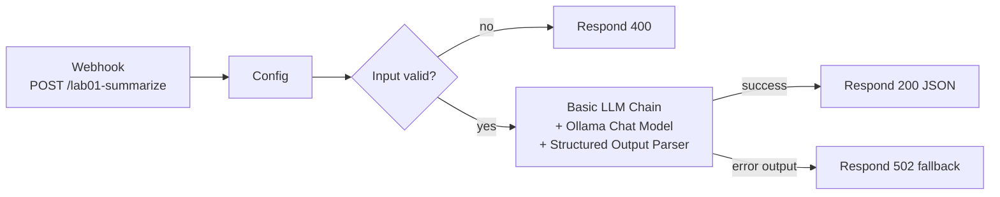

# Module 01 — n8n Lab

The hands-on n8n work for this module is **[Lab 01 — Local LLM and n8n setup](../../labs/lab-01-local-llm-and-n8n-setup/README.md)**.

## What you build

A webhook-driven workflow that takes a support ticket, asks a local model (Ollama `llama3.2`) for a summary and priority, forces the answer into a JSON schema, validates it, and returns either a clean result or a clean error.

Workflow file: [`n8n-workflows/01-basic-llm-workflow.json`](../../n8n-workflows/01-basic-llm-workflow.json).

## Concepts you will see in action

| Concept | Where you see it |
|---|---|
| Tokens and latency | Execution timings; Python lab token counts |
| Temperature | Ollama Chat Model → Options → Sampling Temperature (set to 0.1) |
| Structured output | Structured Output Parser with a JSON schema |
| Hallucination control | System prompt: "use only the ticket text"; `unknown` allowed |
| Error handling | Node Settings: Retry On Fail, On Error → Continue (using error output) |

## Module exercises (after the lab)

1. Change temperature to 0.9 and run the same ticket five times. Record how the summary varies.
2. Send a ticket with no priority clues. Does the model return `unknown`, or guess?
3. Send a 5,000-word ticket. What happens to latency? (Hint: input tokens.)
4. Stop the Ollama container (`docker compose stop ollama`) and send a request. Confirm you get the 502 fallback, not a hang. Restart it afterwards.

Record your observations in your Module 01 learning-progress issue.
