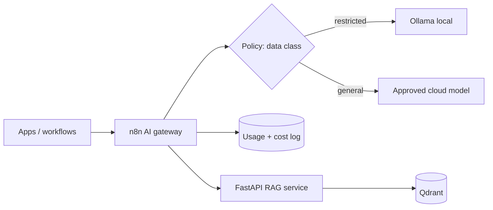

# Module 09 — Architecture

> **Status: outline.** Structure and key points are in place; full content is tracked in [docs/11-suggested-first-issues.md](../../docs/11-suggested-first-issues.md).

## Related reference architectures

- [AI gateway](../../architectures/ai-gateway.md)
- [Hybrid cloud/local AI](../../architectures/hybrid-cloud-local-ai.md)
- [n8n reference architectures](../../architectures/n8n-reference-architectures.md)

## To be written

- [ ] Component-by-component explanation
- [ ] Deployment options (local, cloud, hybrid) and trade-offs
- [ ] Scaling and resilience notes
