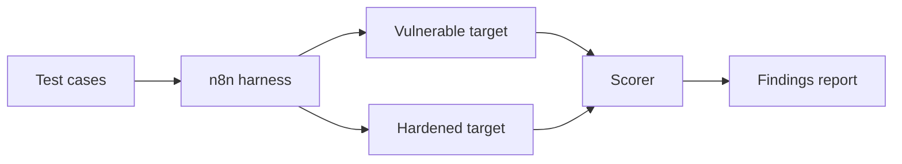

# Module 12 — Architecture

> **Status: outline.** Structure and key points are in place; full content is tracked in [docs/11-suggested-first-issues.md](../../docs/11-suggested-first-issues.md).

## Related reference architectures

- [Secure AI reference architecture](../../architectures/secure-ai-reference-architecture.md)

## To be written

- [ ] Component-by-component explanation
- [ ] Deployment options (local, cloud, hybrid) and trade-offs
- [ ] Scaling and resilience notes
