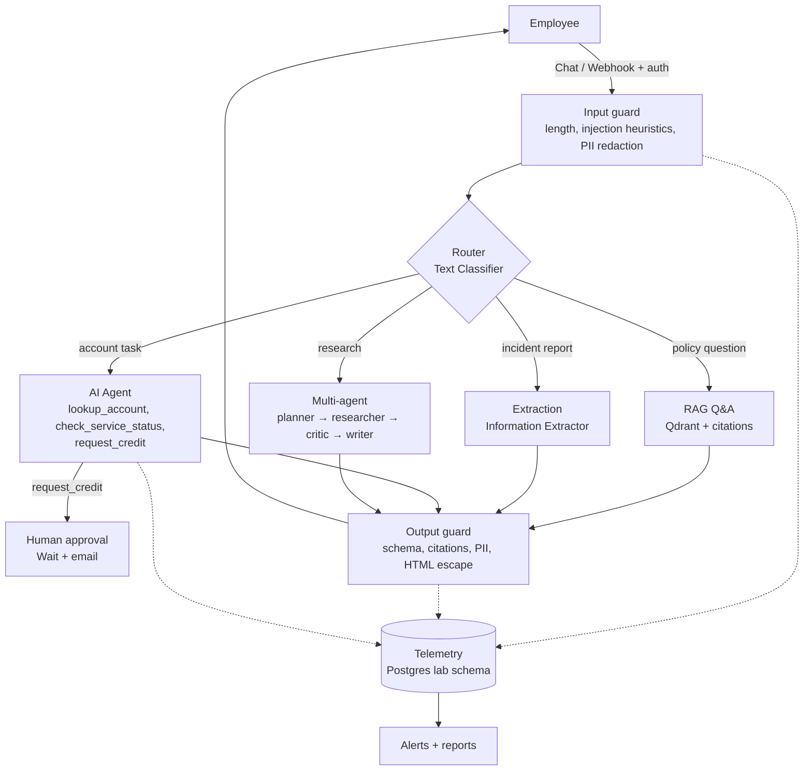

# Module 14 — Capstone: Secure Enterprise Knowledge and Workflow Assistant

**Phase 13 · Week 12 (standard) / Week 4 (accelerated) · 8–20 hours · Advanced**

## Why this matters

The capstone proves you can do the whole job of an AI solutions advisor: discover, design, build, secure, measure, demo and sell. The output is a portfolio piece you can adapt for real customer conversations.

## The scenario

**Northwind Logistics** (fictional, ~5,000 employees) wants an internal assistant for its IT and operations teams. Employees should be able to:

1. Ask questions about IT and security policies and get **answers with citations**.
2. **Summarise and extract** key fields from incident reports.
3. Ask an agent to **look up** account and service status, and **request** a service credit for a customer (a sensitive action needing approval).
4. Request a **research brief** on a topic (for example "risks of adopting passkeys"), produced by a multi-agent flow.

The CISO requires guardrails, an audit trail and evidence of security testing. The CFO wants a business case. The CIO wants to know whether it can run on-prem.

Use only synthetic data. You may reuse and extend the knowledge base from Lab 04.

## Functional requirements

| # | Requirement | Building blocks |
|---|---|---|
| F1 | n8n is the orchestration layer for all flows | All modules |
| F2 | RAG Q&A over the policy knowledge base, with citations and an insufficient-context response | [Workflow 03](../../n8n-workflows/03-rag-workflow.json), [workflow 09](../../n8n-workflows/09-secure-rag-guardrails.json) |
| F3 | Summarisation and field extraction for incident reports to a JSON schema | [Workflow 04](../../n8n-workflows/04-document-processing-workflow.json) |
| F4 | A single agent with **at least two tools** | [Workflow 06](../../n8n-workflows/06-single-agent-tool-use.json) |
| F5 | A multi-agent flow (planner, researcher, critic, writer) | [Workflow 07](../../n8n-workflows/07-multi-agent-orchestration.json) |
| F6 | **Human approval** for at least one sensitive action | [Workflow 08](../../n8n-workflows/08-human-approval-workflow.json) or n8n's built-in tool human review |
| F7 | **Input and output guardrails** on every user-facing entry point | [Workflow 09](../../n8n-workflows/09-secure-rag-guardrails.json) |
| F8 | A single entry point (chat or webhook) that routes to F2–F5 | Switch / Text Classifier |

## Non-functional requirements

| # | Requirement | Evidence |
|---|---|---|
| N1 | Log prompts (redacted), responses (redacted), tool calls, latency, tokens, errors and user feedback | Rows in `lab.llm_calls`, `lab.tool_call_log`, `lab.workflow_errors` ([workflow 10](../../n8n-workflows/10-observability-workflow.json)) |
| N2 | Runs fully locally (Ollama) with an optional cloud route documented | Architecture diagram |
| N3 | No secrets or real data in workflows or Git | `make validate` passes; review checklist |
| N4 | Error workflow configured for every production workflow | Workflow settings screenshot |
| N5 | p95 latency and cost per request measured | Eval report |

## Evaluation set

Create `capstone-eval.jsonl` with **at least 25 cases**:

| Category | Minimum | Example |
|---|---|---|
| Policy Q&A with known answer | 10 | "How long are VPN logs retained?" |
| Out-of-scope / insufficient context | 4 | "What's the CEO's salary?" |
| Extraction | 4 | Incident report → fields |
| Agent tool use | 4 | "What's the status of account ACME-001?" |
| Adversarial (from Lab 11) | 3+ | Indirect injection document |

Report: correctness, citation validity, refusal correctness, latency p50/p95, tokens per request, and red-team pass rate.

## Deliverables (the consultant pack)

| # | Deliverable | Template |
|---|---|---|
| D1 | Working n8n workflows (exported JSON, no credentials) | [Design review checklist](../../templates/n8n-workflow-design-review-checklist.md) |
| D2 | Architecture diagram (Mermaid) with trust boundaries | [Secure AI reference architecture](../../architectures/secure-ai-reference-architecture.md) |
| D3 | Threat model | [AI security playbook §1](../../docs/06-ai-security-playbook.md) |
| D4 | Security review | [Security review checklist](../../templates/security-review-checklist.md) |
| D5 | Risk register (≥ 10 risks) | [Risk register](../../templates/risk-register.md) |
| D6 | Red-team findings report | [Lab 11](../../labs/lab-11-ai-security-red-team/README.md) |
| D7 | Evaluation results | Eval runner output + summary |
| D8 | 10-minute demo + script | [Demo script](../../templates/demo-script.md) |
| D9 | Executive one-pager | [Executive briefing](../../templates/executive-briefing.md) |
| D10 | POC plan | [POC plan](../../templates/poc-plan.md) |
| D11 | Business case (ROI/TCO) | [ROI/TCO outline](../../templates/roi-tco-outline.md) |

## Reference architecture

## Suggested build plan

| Day | Work |
|---|---|
| 1 | Discovery role-play, use-case assessment, architecture draft, threat model draft |
| 2 | Router + RAG + guardrails |
| 3 | Agent + approval + extraction |
| 4 | Multi-agent + telemetry + error workflow |
| 5 | Eval set, red-team run, fixes |
| 6 | Artifacts, demo rehearsal, readout |

## Scoring rubric (100 points)

| Area | Points | What "excellent" looks like |
|---|---|---|
| Functionality (F1–F8) | 25 | All flows work end to end from one entry point |
| Security (guardrails, approval, least privilege, threat model, red team) | 25 | Layered controls; findings fixed or accepted with rationale |
| Measurement (logging, eval, metrics) | 15 | 25+ eval cases; clear metrics; honest limitations |
| Architecture and documentation | 15 | Clear diagrams, trust boundaries, deployment options |
| Consultant artifacts | 10 | Customer-ready one-pager, POC plan, business case |
| Demo and communication | 10 | Clear story for both technical and executive audiences |

Pass: 70. Distinction: 85.

## Module files

[Learning objectives](learning-objectives.md) · [Concepts](concepts.md) · [n8n lab](n8n-lab.md) · [Python lab](python-lab.md) · [Architecture](architecture.md) · [Security](security-considerations.md) · [Troubleshooting](troubleshooting.md) · [Customer prompts](customer-conversation-prompts.md) · [Knowledge check](knowledge-check.md) · [Resources](resources.md) · [Progress checklist](progress-checklist.md)

Build guide: [Lab 13 — Capstone](../../labs/lab-13-capstone-secure-ai-advisor/README.md).

## After the capstone

You have completed the program. Revisit the [completion criteria](../../docs/00-learning-path.md#completion-criteria).
