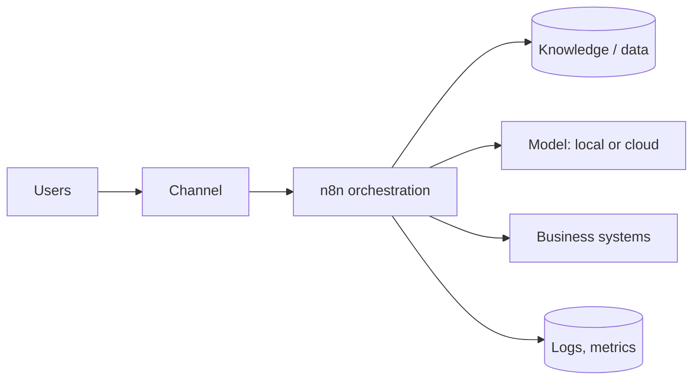

# Solution Design One-Pager — <Use case>

> **Status: outline.** Structure is ready to use; worked examples are tracked in [docs/11-suggested-first-issues.md](../docs/11-suggested-first-issues.md) (issue #14).

**Customer:** ____ · **Version:** ____ · **Author:** ____

| Section | Content (keep each to 2–4 lines) |
|---|---|
| Problem | |
| Proposed solution | |
| Users and channels | |
| Key capabilities | |
| Architecture (diagram below) | |
| Data sources and classification | |
| Model strategy | Local / cloud / hybrid, and why |
| Security and governance controls | Identity, entitlements, guardrails, approvals, logging |
| Integration points | |
| Deployment and operations | Hosting, monitoring, support, backups |
| Success metrics | |
| Risks and mitigations (top 3) | |
| Next step | |

## Reference architecture

See [architectures/](../architectures/enterprise-rag.md) for detailed patterns.
