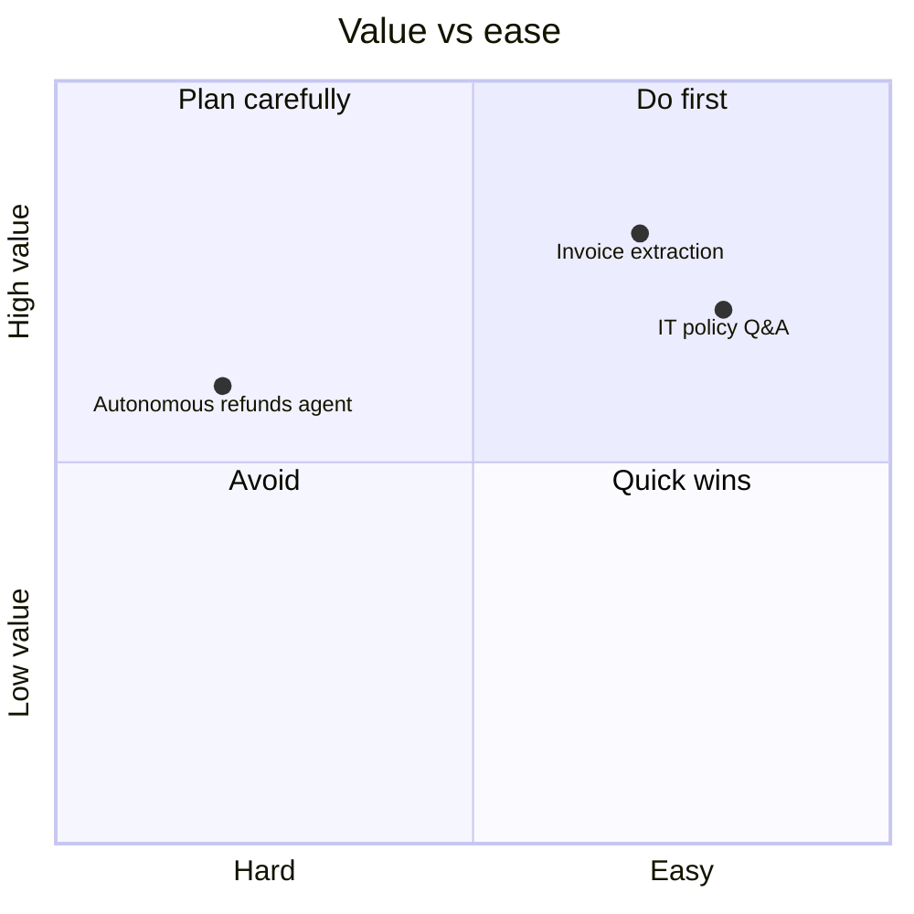

# Use-Case Assessment and Prioritisation Matrix

> **Status: outline.** Structure is ready to use; worked examples are tracked in [docs/11-suggested-first-issues.md](../docs/11-suggested-first-issues.md) (issue #14).

## 1. Use-case card (one per idea)

| Field | Entry |
|---|---|
| Name | |
| One-line description (who, does what, with what, to achieve what) | |
| Category | Conversational AI / Document AI / Workflow automation / Agentic AI |
| Business owner | |
| Users and volume | |
| Current cost / time / error rate | |
| Target outcome and KPI | |
| Data sources and classification | |
| Autonomy level | Suggest / Act with approval / Autonomous |
| Worst-case failure | |

## 2. Scoring (1 = low, 5 = high)

| Criterion | Weight | Guidance |
|---|---|---|
| Business value | 30% | Hours saved, revenue, risk reduction, customer experience |
| Feasibility | 20% | Integrations available, model capability proven for this task |
| Data readiness | 20% | Accessible, owned, current, permissioned |
| Risk (inverted: 5 = low risk) | 20% | Impact of errors, data sensitivity, regulatory exposure, autonomy |
| Time to value | 10% | Can a POC show value in 4 weeks? |

## 3. Prioritisation matrix

| Use case | Value | Feasibility | Data | Risk (inv.) | Time | Weighted score | Decision |
|---|---|---|---|---|---|---|---|
| | | | | | | | Now / Next / Later / No |

## To be written
- [ ] Worked example with three use cases
